# 01 — System Overview

[Docs home](README.md) · Next: [02 — Hardware and infrastructure](02-hardware-and-infrastructure.md)

---

## 1. Purpose

The system builds a grounded question-answering service over recent multilingual news.
It ingests CC-NEWS web archives, keeps Arabic, English, and French articles, turns them
into versioned text chunks, LLM analyses, and vector embeddings, and answers questions
with citations to the stored chunks.

## 2. Scope

| In scope (implemented) | Confidence |
|---|---|
| Quota-bounded, resumable ingestion of one CC-NEWS monthly manifest per run | Verified in code |
| HTML extraction, language detection, and filtering to `ar`, `en`, `fr` | Verified in code |
| Deterministic cleaning, splitting (800 characters, 100 overlap), and noise filtering | Verified in code |
| LLM chunk analysis through a pluggable backend (Groq adapter included) | Verified in code (5 of the 60 analyses in the current snapshot failed with Groq 429; see [02 §6.1](02-hardware-and-infrastructure.md#61-prototype-snapshot-baseline-units)) |
| CPU embedding with BGE-M3 INT8 ONNX into pgvector | Verified in code |
| CLI RAG agent: query planning, exact cosine search, cross-encoder reranking, cited answers | Verified in code |
| Database inspection, CSV export, and embedding progress monitoring | Verified in code |

| Out of scope today | Status |
|---|---|
| Continuous or scheduled operation of any stage | Proposed (not implemented) |
| HTTP query API (`query_service/` is an empty package) | Proposed (not implemented) |
| Monitoring, alerting, secrets management, backups | Proposed (not implemented) |
| Infrastructure provisioning (VMs, Hadoop, PostgreSQL) | Not in repository; kept in [[FILL: where VM, Hadoop and PostgreSQL provisioning is kept]] |
| Arabic dialect identification (`metadata.arabic_dialect` is always `NULL`) | Not implemented (Verified in code: `_candidate` in [ingestion/pipeline.py](../ingestion/pipeline.py)) |
| Languages other than Arabic, English, French | Excluded by design (Verified in code: [ingestion/text.py](../ingestion/text.py)) |

## 3. System context

**Level 1: big picture**

*Source: [diagrams/src/01-system-context.mmd](diagrams/src/01-system-context.mmd)*

An operator runs the batch jobs and an analyst asks questions; both are external actors,
drawn in orange. News enters only from Common Crawl, the LLM APIs are Groq (tagging and
answering) and Google Gemini (answering only), and PostgreSQL with pgvector holds all
state. One-time model downloads from Hugging Face are omitted. *(Verified in code: [retrieval/llm.py](../retrieval/llm.py), setup scripts in [scripts/](../scripts/))*

## 4. High-level architecture

The system splits into a **processing plane** (Spark jobs that write data) and a
**query plane** (a local process that reads it). The two diagrams below show each
plane; every module is listed in the [component map](#5-component-map).

### 4.1 Processing plane

**Level 2: processing pipeline**

*Source: [diagrams/src/01-processing-pipeline.mmd](diagrams/src/01-processing-pipeline.mmd)*

Arrows show the logical order of data. In practice every stage reads its input from
PostgreSQL and writes its output back there, so the stages never call one another and
tagging and embeddings can run in parallel. Launch scripts (`scripts/`), the shared
runtime (`jobs/`), the database stores (`db/`), and the Groq calls made by tagging are
described in [§5](#5-component-map). *(Verified in code)*

### 4.2 Query plane

**Level 2: query side**

*Source: [diagrams/src/01-query-side.mmd](diagrams/src/01-query-side.mmd)*

The LLM turns the question into at most three search queries, each embedded with
BGE-M3 and searched by exact cosine distance in PostgreSQL. A local cross-encoder
reranks the candidates, and the LLM writes an answer that cites chunk IDs, with one
optional follow-up search round. This runs in `.venv-rag` through `scripts/ask.py`; the
empty `query_service/` package is reserved for the proposed API. *(Verified in code:
[retrieval/](../retrieval/))*

## 5. Component map

| Module | Path | Responsibility | Runs on | Python env | Entry point | Reads | Writes |
|---|---|---|---|---|---|---|---|
| Ingestion | [ingestion/](../ingestion/) | Manifest selection, WARC streaming, extraction, language filter, quotas | Spark driver + executors | `.venv` (packed) | `scripts/run_ingestion.sh` | Common Crawl | `websites`, `authors`, `pages`, `metadata`, `content`, `ingest_*` |
| Chunking | [chunking/](../chunking/) | Cleaning, splitting, noise flags, chunk hashing | Spark | `.venv` (packed) | `scripts/run_chunking.sh` | `pages`, `content`, `metadata` | `article_chunks`, `chunk_materializations` |
| Tagging | [tagging/](../tagging/) | LLM summary, category, tags per eligible chunk | Spark executors to Groq | `.venv` (packed) | `scripts/run_tagging.sh` | `article_chunks`, `metadata` | `chunk_analyses` |
| Embeddings | [embeddings/](../embeddings/) | BGE-M3 INT8 ONNX vectors (1024-dim, L2-normalized) | Spark executors | `.venv-embedding-onnx` (packed) | `scripts/run_embeddings.sh` | `article_chunks` | `chunk_embeddings` |
| Retrieval | [retrieval/](../retrieval/) | RAG agent, vector search, reranking, evidence, LLM providers | Local process | `.venv-rag` | `scripts/ask.py` | `chunk_embeddings` plus joins | stdout only |
| DB | [db/](../db/) | Connections, migrations, transactional commits, stage stores, inspection | Driver / local | any | `scripts/inspect_db.sh` | all tables | all tables |
| Jobs | [jobs/](../jobs/) | Spark session, wave executor, config resolution, `.env` loading | Driver | `.venv` | used by launchers | — | — |
| Scripts | [scripts/](../scripts/) | Launchers, packaging, model setup, export, monitoring | Spark master / local | various | — | — | `exports/`, `.build-tmp/`, `.models/` |
| Query service | [query_service/](../query_service/) | Empty placeholder | — | — | — | — | — |
| Tests | [tests/](../tests/) | Unit, integration (`WARC_TEST_DSN`), and Spark smoke tests | Local | `.venv` + optional deps | `python -m unittest` | disposable DB | disposable schemas |

A detailed page per module is planned for 04-modules (not written yet). Until then,
[archive/module_map.md](archive/module_map.md) lists function signatures and payloads.

## 6. Design principles

| Principle | Mechanism | Source |
|---|---|---|
| Single writer per stage | Only the driver touches PostgreSQL; executors receive and return plain dicts | [jobs/batching.py](../jobs/batching.py), stage `pipeline.py` files |
| One coordinator per stage | Session advisory locks; the ingestion lock is global across manifests | `acquire_coordinator_lock` in [db/db_handler.py](../db/db_handler.py), `acquire_lock` in [db/chunks.py](../db/chunks.py) |
| Bounded memory | Item, input-byte, and result-byte limits per task; HTML and article size caps | [jobs/runtime.py](../jobs/runtime.py), [ingestion/pipeline.py](../ingestion/pipeline.py) |
| Idempotent commits | Ingestion chunk receipts; `ON CONFLICT` keys; hash checks on chunks and vectors | [db/](../db/) stores |
| Versioned derived data | New version strings produce new rows instead of overwriting | `CHUNKING_VERSION`, `analysis_version`, `model_version()` |
| Resumability | Re-running a stage selects only rows missing for the current version; ingestion resumes by `RESUME_RUN_ID` | stage stores, `restore_run_config` |
| No hidden fallbacks | Missing model files, hash drift, or quota overflow raise errors instead of degrading | [retrieval/reranker.py](../retrieval/reranker.py), [db/chunks.py](../db/chunks.py) |

All rows above are *Verified in code*.

## 7. Version keys connecting the stages

Downstream stages find their input by version key. The table shows the defaults
currently in code.

| Key | Default value | Set by | Source |
|---|---|---|---|
| `chunking_version` | `recursive-800-100-clean-v2.4.1-v1` | `CHUNKING_VERSION` constant; `--chunking-version` flag | [chunking/__init__.py](../chunking/__init__.py) |
| Tagging `backend` | `groq` | `TAGGING_BACKEND` / `--backend` | [jobs/runtime.py](../jobs/runtime.py) |
| Tagging `model` | `qwen/qwen3.8-27b` | `TAGGING_MODEL` / `--model` | [jobs/runtime.py](../jobs/runtime.py) |
| `analysis_version` | `chunk-analysis-v2.4.1` | `TAGGING_ANALYSIS_VERSION` / `--analysis-version` | [jobs/runtime.py](../jobs/runtime.py) |
| `embedding_model` | `BAAI/bge-m3-int8` | `EMBEDDING_MODEL` / `--model` | [jobs/runtime.py](../jobs/runtime.py) |
| `embedding_version` | `bge-m3-int8-<20 hex chars>`: the first 20 hex characters of a SHA-256 over the label `cls-l2-raw-text-v1`, `max_length`, and four model files (see below) | `model_version()`; only the RAG query path honours an `EMBEDDING_VERSION` override (see warning) | [embeddings/embeddings.py](../embeddings/embeddings.py#L22-L35) |

`model_version()` hashes these four files from the model directory
(`EMBEDDING_MODEL_DIR`, default `.models/bge-m3-int8`), and fails if any is missing:

- `onnx/model_int8.onnx`
- `tokenizer.json`
- `tokenizer_config.json`
- `1_Pooling/config.json`

It does **not** include the ONNX Runtime version, the CPU instruction set, the batch
size, or the thread count. *(Verified in code)*

> **Warning: version mismatch between writing and reading vectors.** The embedding
> stage always computes `model_version()` and ignores `EMBEDDING_VERSION`
> ([embeddings/pipeline.py](../embeddings/pipeline.py#L36)); so does
> `scripts/watch_embeddings.py` ([L63](../scripts/watch_embeddings.py#L63)). The RAG
> query path reads `EMBEDDING_VERSION` first and falls back to `model_version()`
> ([retrieval/store.py](../retrieval/store.py#L42)). If `EMBEDDING_VERSION` is set, the
> query side can search a different version from the one the embedding stage writes,
> and an empty result looks like "no evidence". *(Verified in code; also reported in
> [archive/embedding-runtime-consistency.md](archive/embedding-runtime-consistency.md) §3)*

The current data snapshot in `exports/` uses `embedding_version =
bge-m3-int8-9fb3afc85bfa0f8662dd`. *(Verified from exports/chunk_embeddings.csv)*

## 8. Technology stack

| Layer | Technology | Version | Source |
|---|---|---|---|
| Language | Python 3; Bash | 3.13.5 in the local `.venv`, `.venv-embedding-onnx`, and `.venv-rag` (Recorded); 3.12 in the Modal image (Verified in code) | [archive/embedding-runtime-consistency.md](archive/embedding-runtime-consistency.md) §7.1; `python_version="3.12"` in [scripts/modal_embedding_app.py](../scripts/modal_embedding_app.py#L44) |
| Processing | Apache Spark on YARN (client mode), HDFS | Spark 4.2.0 recorded; Hadoop [[FILL: Hadoop version on the cluster]] | [scripts/run_processing.sh](../scripts/run_processing.sh); [archive/validation.md](archive/validation.md) |
| Database | PostgreSQL + pgvector | PostgreSQL 18 recorded in tests; live server [[FILL: PostgreSQL server version on the live database]]; pgvector [[FILL: pgvector extension version]] | [db/vector_schema.py](../db/vector_schema.py); [archive/validation.md](archive/validation.md) |
| WARC parsing | FastWARC | `==1.0.9` | [requirements/base.txt](../requirements/base.txt) |
| Extraction | trafilatura, selectolax, charset-normalizer | `>=2,<3`; `>=0.3,<0.5`; `>=3.4,<4` | [requirements/base.txt](../requirements/base.txt) |
| Language ID | lingua-language-detector | `==2.2.0` | [requirements/base.txt](../requirements/base.txt) |
| DB driver | psycopg2-binary, pgvector (Python) | `>=2.9,<3`; `>=0.3,<1` | requirements files |
| Text splitting | langchain-text-splitters, langchain-core | `>=1,<2` | [requirements/rag.txt](../requirements/rag.txt) |
| LLM clients | langchain-groq, langchain-google-genai | `>=1,<2`; `>=4,<5` | [requirements/rag-agent.txt](../requirements/rag-agent.txt) |
| Model runtime | onnxruntime (CPU), transformers (tokenizers) | `>=1.20,<2`; `>=4.45,<6`. The Modal app pins `onnxruntime==1.30.0`. | [requirements/embedding-worker-onnx.txt](../requirements/embedding-worker-onnx.txt); [scripts/modal_embedding_app.py](../scripts/modal_embedding_app.py#L49) |
| Embedding model | BGE-M3, INT8 ONNX (`onnx-community/bge-m3-ONNX`, pinned revision) | revision `25b9af8e...` | [scripts/download_quantized_embedding_model.sh](../scripts/download_quantized_embedding_model.sh) |
| Reranker model | bge-reranker-v2-m3, INT8 ONNX (pinned, SHA-256 verified) | revision `90213ffc...` | [scripts/download_quantized_reranker_model.sh](../scripts/download_quantized_reranker_model.sh) |
| Schemas | pydantic | `>=2,<3` | requirements files |
| Packaging | venv-pack, zip, HDFS cache | `==0.2.0` | [scripts/run_processing.sh](../scripts/run_processing.sh) |

### Python environments

| Environment | Requirements file | Used by | Shipped to executors |
|---|---|---|---|
| `.venv` | `requirements/base.txt`, plus `rag.txt` and `tagging-groq.txt` for processing | Launcher bootstrap, ingestion, chunking, tagging, `inspect_db.sh` | Yes (packed per fingerprint) |
| `.venv-embedding-onnx` | `requirements/embedding-worker-onnx.txt` | Embedding stage, `watch_embeddings.sh` | Yes |
| `.venv-rag` | `requirements/rag-agent.txt` | `scripts/ask.py`, reranker download | No |
| (dev) `.venv` + `requirements/dev.txt` | `base.txt` + `warcio` | Tests | No |

`requirements/embeddings.txt` installs FastAPI, uvicorn, and langdetect. No pipeline or
retrieval module imports them, and no launcher or setup script installs that file (the
project [README.md](../README.md) calls it optional, for the retrieval API). The only
FastAPI import is in [scripts/modal_embedding_app.py](../scripts/modal_embedding_app.py#L180),
which installs its own packages (`fastapi[standard]`) inside the Modal image. Nothing
imports uvicorn or langdetect. *(Verified in code)*

## 9. Prototype and production at a glance

| Aspect | Prototype (today) | Production (Proposed, not implemented) |
|---|---|---|
| Trigger | Operator runs each stage script by hand (`run_ingestion.sh` with quotas, then chunking, tagging, embeddings) | An **hourly cycle**: check for new CC-NEWS WARC data, queue new links, then run ingestion, chunking, tagging, and embeddings |
| Embedding runtime | Spark executors on the workers, stock ONNX Runtime on CPU | **Modal**, with an AVX2-only ONNX Runtime wheel so every host computes identical vectors. The local driver still reads pending chunks and commits vectors; Modal stays stateless. Decision status: [[FILL: is moving embeddings to Modal decided]] |
| Query interface | `scripts/ask.py` CLI | FastAPI service in `query_service/` wrapping `retrieval.answer()` |
| Observability | stdout, Spark UI, `inspect_db.sh`, `watch_embeddings.sh` | Metrics, dashboards, alerting |
| Secrets | `.env` file and environment variables | Secrets manager (adds the Modal proxy token, `MODAL_PROXY_TOKEN`) |
| Backups | None in repository | Scheduled PostgreSQL backups |

Sources: the hourly cycle and the Modal design are from
[archive/embedding-runtime-consistency.md](archive/embedding-runtime-consistency.md)
§1, §6, and §7. That document is a decision record, not code: the embedding stage still
runs on Spark, and the Modal scripts in `scripts/modal_*.py` are investigation and
validation tools only. The cluster-level view is in
[03 §11](03-cluster-design.md#11-prototype-vs-production-cluster).

## 10. Conventions

- **Exit codes** *(Verified in code)*:
  - Ingestion: `0` complete, `1` failure, `2` shortfall or no files selected.
  - Chunking, tagging, embeddings: `0` success, `1` failure, `2` tagging quota or long provider cooldown, `130` interrupted.
  - `ask.py`: `0` sufficient answer, `1` insufficient evidence.
- **Configuration precedence** for launchers: CLI flag, then an exported variable, then `.env`, then the code default. *(Verified in code: [jobs/environment.py](../jobs/environment.py) loads `.env` with `override=False`)*
- **Working directory**: run all commands from the project root. Launchers `cd` to the root themselves. *(Verified in code)*
