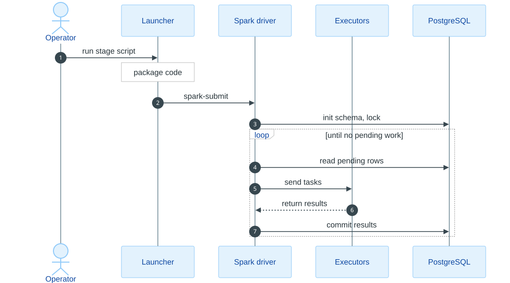

# 03 — Cluster Design

[Docs home](README.md) · Previous: [02 — Hardware and infrastructure](02-hardware-and-infrastructure.md) · Next: [04 — Modules](04-modules/)

---

This page describes how work is placed on the cluster, how code and models reach the
workers, which ports and storage are involved, and how the system behaves under scale
and failure. Physical specifications are in
[02-hardware-and-infrastructure.md](02-hardware-and-infrastructure.md).

## 1. Cluster layout

*Source: [diagrams/src/03-cluster-layout.mmd](diagrams/src/03-cluster-layout.mmd)*

The master runs the launchers and the Spark driver, which sends bounded tasks to one
single-core executor on each worker. Workers call external sites over HTTPS (Common
Crawl when ingesting, Groq when tagging) but never connect to PostgreSQL: only the
driver reads and writes the database. HDFS, PostgreSQL, and query-node hosts are
TODO(team); ports are in [§6](#6-networking-and-ports).
*(Verified in code: [scripts/run_processing.sh](../scripts/run_processing.sh), [jobs/runtime.py](../jobs/runtime.py))*

## 2. Node roles and services

| Node | Services | Stage role | Confidence |
|---|---|---|---|
| spark-master | YARN ResourceManager (`:8032`); Spark driver of every stage; launcher packaging; `inspect_db.sh`, `export_csv.sh`, `watch_embeddings.sh` | Coordinator and sole database writer | ResourceManager: Recorded. Driver placement: Verified in code (client mode) |
| worker1–3 | YARN NodeManager; Spark executors | Pure transforms: WARC parsing, cleaning and splitting, LLM calls, ONNX inference | Recorded (names); Verified in code (behavior) |
| HDFS NameNode / DataNodes | HDFS | Archive cache and event logs | Verified in code (usage); placement TODO(team) |
| PostgreSQL host | PostgreSQL + pgvector | System of record | Placement TODO(team) |
| Query node | `.venv-rag` process | RAG question answering | Placement TODO(team) |

## 3. How workloads are split

### 3.1 Per-stage placement and defaults

| Stage | Driver does | Executors do | Default executors / parallel tasks | Task size | External calls from executors |
|---|---|---|---|---|---|
| **ingest** | Fetches the manifest, allocates tasks per file with quota allowances, commits each result transactionally, advances checkpoints | Stream one WARC file from a saved offset, extract, filter, return up to `WORKER_MAX_CANDIDATES` candidates | 3 / `MAX_FILES_PER_ROUND` = executor count | One file per task; at most 100 candidates, 4 MiB result, 32 MiB input, 120 s | Common Crawl |
| **chunk** | Streams pending articles, packs tasks, commits one document per transaction | Clean, split, flag noise, hash chunks | 3 / 3 | 25 documents; 2 MiB input; 4 MiB result | None |
| **tag** | Streams pending eligible chunks, commits each batch | Call the LLM backend per chunk with rate shaping and retries | 3 / 3 | 10 chunks; 2 MiB input; 1 MiB result | Groq |
| **embed** | Pins `embedding_version`, streams pending eligible chunks, validates and commits vectors | ONNX inference, CLS pooling, L2 normalization | 2 / 2 | 10 chunks; 2 MiB input; 1 MiB result | None |

*Verified in code:* `load_config` and `_allocate_tasks` in [ingestion/pipeline.py](../ingestion/pipeline.py),
`config()` in [jobs/runtime.py](../jobs/runtime.py).

### 3.2 Execution models

- **Ingestion** uses `execute_batch`: one Spark job per wave, with one partition per
  file task. The driver waits for the **whole wave**, then commits results in order.
  *(Verified in code)*
- **Chunking, tagging, and embeddings** use `run_waves`:
  - Each task is an **independent single-partition Spark job**, submitted from a thread pool of size `parallel_tasks`.
  - Each result is committed as soon as it completes.
  - If a task fails, the remaining siblings in the wave are drained and committed before the error is raised, so paid LLM responses are not discarded.
  *(Verified in code: [jobs/batching.py](../jobs/batching.py))*

### 3.3 Spark settings applied by the repository

| Setting | Value | Applies to | Source |
|---|---|---|---|
| `--master` / `--deploy-mode` | `yarn` / `client` | all | [scripts/run_processing.sh](../scripts/run_processing.sh) |
| `spark.executor.cores` | `1` | all | same |
| `spark.executor.instances` | resolved count (see §3.1) | all | same |
| `spark.dynamicAllocation.enabled` | `false` | all | same |
| `spark.driver.maxResultSize` | `64m` | all | same |
| `spark.executorEnv.{RAYON,OMP,OPENBLAS}_NUM_THREADS` | `1` | all | same |
| `spark.pyspark.python` | `./environment/bin/python` (from the packed venv archive) | all | same |
| `spark.python.worker.reuse` | `true` | all | [jobs/runtime.py](../jobs/runtime.py) |
| `spark.redaction.regex`, `spark.redaction.string.regex` | secret, password, token, and API-key patterns; `gsk_...` Groq keys | all | same |
| `spark.task.maxDirectResultSize` | `16m` | ingest | same |
| `spark.speculation` / `spark.task.maxFailures` | `false` / `1` | chunk, tag, embed | same, and [scripts/run_processing.sh](../scripts/run_processing.sh) |
| `spark.executorEnv.GROQ_API_KEY`, `TAG_*` pacing | from the environment | tag (Groq backend) | [jobs/runtime.py](../jobs/runtime.py) |
| `spark.executorEnv.EMBEDDING_MODEL_DIR` | `./embedding-model` (localized archive) | embed | same |
| `spark.executorEnv.EMBEDDING_INTRA_OP_THREADS` | `1` | embed | same |
| `spark.yarn.archive` | `hdfs://.../spark-libs-<hash>.zip` | all, when the HDFS cache is used | [scripts/run_processing.sh](../scripts/run_processing.sh) |

Ingestion does not override `spark.task.maxFailures`, so Spark's default task retry
count applies *(Inferred)*. The worker also retries transient HTTP errors itself
(`MAX_RETRIES`, default 3). *(Verified in code)*

## 4. Job lifecycle

*Source: [diagrams/src/03-job-lifecycle.mmd](diagrams/src/03-job-lifecycle.mmd)*

The launcher loads `.env`, validates flags with the stage's own parser, packages code
and environments, and calls `spark-submit`; with `--dry-run` it prints the resolved
configuration and stops before packaging. The driver then initializes the schema, takes
the stage's advisory lock, and loops: read pending rows, send bounded tasks, commit each
result, until nothing is pending.
*(Verified in code: [scripts/run_processing.sh](../scripts/run_processing.sh), [jobs/](../jobs/))*

## 5. Code, environment, and model distribution

*Source: [diagrams/src/03-code-distribution.mmd](diagrams/src/03-code-distribution.mmd)*

Project code is zipped on every launch and shipped with `--py-files`. The large
artifacts (Python environment, Spark jars, embedding model) are uploaded once to the
HDFS cache and reused while their content fingerprint is unchanged:

- **Python environment.** Packed with `venv-pack`. Its fingerprint hashes the requirement files, `pyvenv.cfg`, installed distributions, the Python version, and the interpreter path.
- **Spark jars.** Fingerprinted by the SHA-256 of every jar in `SPARK_HOME/jars`.
- **Embedding model.** Fingerprinted by the SHA-256 of every file in the model directory.

When `USE_HDFS_CACHE=1` (the default) and `hdfs dfs -test -e /` succeeds, each archive
is uploaded once to `HDFS_APPS_DIR` with an atomic upload-then-rename. If HDFS is
unavailable, the local archives are shipped with every job instead. Old archives are
never deleted, locally or on HDFS. *(Verified in code: [scripts/run_processing.sh](../scripts/run_processing.sh))*

Because the packed venv embeds its interpreter path, **every worker must have the same
Python version and the same interpreter path as the launcher host**
*(Recorded in [README.md](../README.md); Inferred from venv-pack behavior)*.

## 6. Networking and ports

| Port | Service | Host | Required by | Confidence |
|---|---|---|---|---|
| 5432/TCP | PostgreSQL | DB host | Spark driver, query node, `psql` export | Verified in code (default `PGPORT`) |
| 8032/TCP | YARN ResourceManager | spark-master | `spark-submit` | Recorded ([archive/validation.md](archive/validation.md)) |
| TODO(team) | HDFS NameNode RPC | TODO(team) | Launcher (`hdfs dfs`), YARN localization | TODO(team): `hdfs://` URIs in code carry no host, so `fs.defaultFS` decides |
| 4040/TCP | Spark application UI | spark-master (driver) | Operators | Inferred (Spark default; not set in repo) |
| 8088/TCP | YARN ResourceManager web UI | spark-master | Operators | Inferred (Hadoop default; not set in repo) |
| ephemeral | Spark driver RPC and block manager | spark-master ↔ workers | Executors | Inferred (Spark default; firewall rules TODO(team)) |
| 443/TCP outbound | HTTPS | workers, master, query node | Common Crawl, Groq, Gemini, Hugging Face, PyPI | Verified in code |

**Network rules implied by the code:**

1. Workers need outbound HTTPS. They do **not** need database access.
2. The driver host needs database access and must be reachable from the workers on the Spark driver ports.
3. The query node needs database access and outbound HTTPS only.

*(Verified in code; port numbers as labelled above)*

## 7. Storage design

| Data | Store | Writer | Readers | Durability |
|---|---|---|---|---|
| Articles, chunks, analyses, vectors, run state | PostgreSQL | Stage drivers only | Drivers, query node, export | No backup in repo: TODO(team) / Proposed |
| Code and environment archives | `.build-tmp/`, HDFS `HDFS_APPS_DIR` | Launcher | YARN localization | Rebuildable from source |
| Models | `.models/` on the launcher host and query node | Setup scripts | Embedding archive, query node | Re-downloadable (pinned revisions) |
| Rejected rows | `dead_letter/*.jsonl` on the driver host | Ingestion driver | Operators | Local disk only |
| Exports | `exports/`, `/mnt/hgfs/copy_path/warcdb_csv/` | `export_csv.sh` | Analysts | Point-in-time copy |
| Spark event logs | HDFS `/spark-logs/` | Spark | Spark History Server (TODO(team)) | Configured outside repo (Recorded) |

## 8. Concurrency control

| Lock | Key | Scope | Held by | Source |
|---|---|---|---|---|
| Schema migration | `pg_advisory_xact_lock(782936402)` | One transaction | `init_db()` at the start of every stage | [db/db_handler.py](../db/db_handler.py#L158) |
| Ingestion coordinator | first 8 bytes of `sha256("spark-warc-ingestion-coordinator")` | Session; **global** across all manifests, although the error message names the manifest | Ingestion driver | [db/db_handler.py](../db/db_handler.py#L192-L203) |
| Chunking / tagging / embedding coordinator | first 8 bytes of `sha256("spark-warc-<stage>")` | Session, per stage | Each processing driver | [db/chunks.py](../db/chunks.py#L13-L25) |

The locks allow one ingestion driver and one driver per processing stage. **Different
stages may run at the same time**: each one reads only committed rows from the
previous stage, and rows committed after a stage starts are picked up on its next run.
YARN capacity is the practical limit on running stages at the same time (see
[02 §4](02-hardware-and-infrastructure.md#4-yarn-container-budget-per-stage)).
*(Verified in code; capacity limit Inferred)*

## 9. Scaling considerations

| Dimension | Lever | Limit | Confidence |
|---|---|---|---|
| Ingestion throughput | More workers plus `--executor-instances` and `MAX_FILES_PER_ROUND` | At most one task per file per wave; the driver waits for the slowest file before committing the wave | Verified in code |
| Processing throughput | `--executor-instances`, `--parallel-tasks`, `--items-per-task` | Commits are serialized in the driver; tagging is bounded by the LLM rate limit | Verified in code |
| Embedding throughput | More executors; `EMBEDDING_BATCH_SIZE` | One ONNX thread per executor (fixed by the launcher); container memory of 1.5 GiB | Verified in code |
| Query latency | `RAG_DB_CONCURRENCY`, `TOP_K`, `RERANKER_CANDIDATE_K` | Exact cosine search scans every vector of the selected version, so cost grows linearly with corpus size. The existing HNSW index uses `vector_ip_ops` and is not used by the cosine query. | Verified in code |
| Database | Vertical scaling | Single PostgreSQL instance; no replicas or partitioning in repo | Verified in code (absence) |
| Memory per task | `*_TASK_INPUT_BYTES`, `*_TASK_RESULT_BYTES`, `WORKER_MAX_*`, `MAX_HTML_BYTES`, `MAX_ARTICLE_BYTES` | Byte budgets bound payloads, not total process memory | Verified in code |

## 10. Failure handling

| Failure | Ingestion behavior | Processing stages behavior | Recovery action |
|---|---|---|---|
| Transient HTTP error (408, 429, 5xx, timeout) | Worker retries up to `MAX_RETRIES` with backoff `min(30, 2^(n+1))` seconds | n/a (tagging has its own 5-attempt loop) | Automatic |
| Non-transient worker error | Error result committed; file marked `failed`; run ends `failed`, exit 1 | Task fails (`maxFailures=1`); siblings drained; job exits 1 | Ingestion: `RESUME_RUN_ID=<id>` makes failed files eligible again. Processing: rerun the same command. |
| Source file changed (ETag or Last-Modified mismatch) | `IOError`, file marked `failed` | n/a | Investigate the source; resume |
| Server ignores HTTP Range | Replays the stream from byte 0 and skips to the saved record boundary | n/a | Automatic (slower) |
| Commit error or lost acknowledgement | Up to `MAX_RETRIES` attempts; reconnects and re-takes the lock; chunk receipt prevents double insert | Idempotent keys; hash conflicts raise errors | Automatic, or rerun |
| Malformed article row | Savepoint isolates it; row written to `dead_letter/` | n/a | Inspect the JSONL file |
| Driver crash | Uncommitted wave lost; run may stay `running` | Up to `parallel_tasks` uncommitted batches lost (LLM calls may be billed again) | Ingestion: resume by run ID. Processing: rerun. |
| Worker node lost | Spark task retry (default count, Inferred), then worker-level retry | Job fails (`maxFailures=1`) | Rerun |
| Groq daily quota or wait over 15 minutes | n/a | Completed outcomes committed; later waves stop; exit 2 | Rerun after the quota resets |
| HDFS unavailable | Archives shipped per job from local disk | same | Automatic |
| PostgreSQL unavailable at start | `init_db` fails, exit 1 | same | Restore the database, rerun |
| Missing model files | n/a | Embedding launcher exits 1 before submission; RAG raises an error with no fallback | Run the setup scripts |

All rows are *Verified in code* except where marked *Inferred*. Recovery behavior for
the release of PostgreSQL session advisory locks after a crash follows standard
PostgreSQL semantics *(Inferred)*.

## 11. Prototype vs production cluster

*Source: [diagrams/src/03-prototype-vs-production.mmd](diagrams/src/03-prototype-vs-production.mmd)*

Left: today, an operator launches each stage by hand on the master, and analysts query
through the CLI. Right: the **proposed** production layout, where grey dashed nodes do
not exist yet:

- A long-running ingestion service watches the CC-NEWS manifest and reuses the existing checkpoint tables and coordinator lock.
- A scheduler triggers chunking, tagging, and embeddings on a timetable or after each ingestion batch, using the same versioned, idempotent keys.
- A FastAPI service in `query_service/` replaces the CLI as the query entry point.
- Monitoring, alerting, a secrets manager, and database backups complete the operations layer.

Worker count and sizes for production are TODO(team). The per-module changes and the
migration path are in [10-prototype-vs-production.md](10-prototype-vs-production.md).
