# 05 — Data Flow

[Docs home](README.md) · Previous: [04 — Modules](04-modules/README.md) · Next: [06 — Database](06-database.md)

---

> **Code baseline.** `master` at `d794b8c`. Statements are *Verified in code* unless
> labelled otherwise.

This page follows one article from a WARC file to a cited answer, with the payload that
moves at each step.

## 1. End-to-end flow

*Source: [diagrams/src/05-data-flow.mmd](diagrams/src/05-data-flow.mmd)*

Each stage reads its input from PostgreSQL and writes its output back there, so no stage
calls another. Blue steps are the project's own code, and orange ones are external. Green
steps are tables. The four processing stages run on Spark, and the RAG agent runs as a
local process.

## 2. Formats at each step

| Step | Input | Output | Stored in |
|---|---|---|---|
| Ingestion | `warc.paths.gz`, gzip WARC records | Candidate articles | `websites`, `authors`, `pages`, `metadata`, `content`, `ingest_*` |
| Chunking | Article text and metadata | Text chunks with a hash, flag, and reason | `article_chunks`, `chunk_materializations` |
| Tagging | Eligible chunks | Status, summary, category, tags | `chunk_analyses` |
| Embedding | Eligible chunks | 1024-dimensional `float32` vectors | `chunk_embeddings` |
| Retrieval | A question | `RagResult` | Nothing: output only |

Tagging output is not used by retrieval today: `retrieval/store.py` does not read
`chunk_analyses`.

## 3. Ingestion payloads

**Task, sent to an executor:**

| Field | Meaning |
|---|---|
| `chunk_id` | Commit receipt key |
| `file_url`, `start_offset` | What to read, and from where |
| `etag`, `last_modified` | Values saved for this file, to detect a change |
| `candidate_limit` | Allowance for this task |
| `max_result_bytes`, `max_input_bytes`, `max_seconds` | Task budgets |
| `max_html_bytes`, `max_article_bytes`, `min_word_count` | Article limits |
| `use_trafilatura`, `lingua_min_confidence`, `max_retries` | Extraction settings |

**Result, returned to the driver:**

| Field | Meaning |
|---|---|
| `chunk_id`, `file_url`, `start_offset` | Copied from the task |
| `next_offset` | Next record boundary to read |
| `candidates` | Article dictionaries |
| `eof` | The end of the file was proved |
| `etag`, `last_modified` | Current source values |
| `stats` | Counters ([ingestion §7](04-modules/ingestion.md#7-filters-in-order)) |
| `error` | `None`, or `Type: message` |

**Candidate → tables:**

| Candidate fields | Table |
|---|---|
| Domain of `url` | `websites` |
| `author` | `authors`, unless empty or `N/A` |
| `record_id`, `url`, `canonical_url`, `canonical_key`, `text_hash`, `file_url`, `warc_date` | `pages` |
| `title`, dates, `description`, `publisher`, `in_language`, `section`, `language`, `arabic_dialect`, `keywords`, `tags`, `author_names`, counts, `headings`, `html_meta`, `html_size_bytes`, `extraction` | `metadata` |
| `cleaned_text` | `content` |

## 4. Processing payloads

| Stage | Task | Result |
|---|---|---|
| chunk | `items` (`page_id`, `text`, `source`, `title`, `language`), `result_bytes` | `documents`, each with `page_id`, `source_hash`, and `chunks` (`chunk_index`, `chunk_text`, `text_hash`, `eligible`, `filter_reason`) |
| tag | `items` (`page_id`, `chunk_index`, `text`, `language`, `title`), `batch_id`, `backend`, `model`, `result_bytes` | `batch_id`, `outcomes`, `quota_exhausted` |
| embed | `items` (`page_id`, `chunking_version`, `chunk_index`, `text`, `text_hash`), `max_length`, `result_bytes` | `rows` (`page_id`, `chunk_index`, `text`, `text_hash`, `embedding`) |

## 5. How a stage finds its input

| Stage | Pending means |
|---|---|
| chunk | Article with text and no `chunk_materializations` row for this `chunking_version` |
| tag | Eligible chunk with no `chunk_analyses` row for this analysis identity |
| embed | Eligible chunk with no `chunk_embeddings` row for this model and version |

A run takes a snapshot through a cursor. Rows committed after it starts are picked up by
the next run. Stages can therefore run at the same time, and rerunning one continues
where it stopped.

## 6. Query path payloads

| Step | Payload |
|---|---|
| Plan | `QueryPlan`: up to 3 `SearchQuery` (`id`, `query`) |
| Search | For each query, up to `RERANKER_CANDIDATE_K` `SearchHit` rows |
| Rerank | The same hits with `reranker_score`, cut to `TOP_K` per query |
| Evidence | `Evidence`: `text`, `chunk_ids`, `query_ids`, `reranker_score`, `similarity`, `sources` |
| Decide | `AgentDecision`: `action`, `answer`, `citations`, `reason`, `queries` |
| Final answer | `GroundedAnswer`: `answer`, `citations` |
| Result | `RagResult`, see [retrieval §9](04-modules/retrieval.md#9-result) |

**Data sent to external services.** During tagging, each chunk goes to Groq with its title
and language name. At query time, the question and the evidence with its sources go to
Groq or Gemini. The keys involved are in [07 §8](07-configuration.md#8-secrets).

## 7. Where work can be lost

| Failure | Lost | Kept |
|---|---|---|
| Driver crash during ingestion | The current wave | All committed chunks and offsets |
| Driver crash during processing | Up to `parallel_tasks` uncommitted batches | All committed documents, analyses, and vectors |
| One executor task fails | That task | Finished siblings in the wave |

Details are in [03 §10](03-cluster-design.md#10-failure-handling).
