# 06 — Database

[Docs home](README.md) · Previous: [05 — Data flow](05-data-flow.md) · Next: [07 — Configuration](07-configuration.md)

---

> **Code baseline.** `master` at `d794b8c`. Statements are *Verified in code* unless
> labelled otherwise: [db/db_handler.py](../db/db_handler.py),
> [db/enrichment_schema.py](../db/enrichment_schema.py),
> [db/vector_schema.py](../db/vector_schema.py). The live database may differ: see D06 in
> [FILL-IN.md](FILL-IN.md).

The system uses one PostgreSQL database with the `vector` extension, by default `warcdb`.
It is the system of record for articles, derived data, and run state.

## 1. Entity relationships



*Source: [diagrams/src/06-er-diagram.mmd](diagrams/src/06-er-diagram.mmd)*

Articles sit at the top. Chunks hang off `pages`, and analyses and vectors hang off
chunks, keyed by version. The diagram shows the main columns; §3 to §5 list every column.
`ingest_files` is not drawn, because it has no foreign keys.

## 2. Table overview

| Table | Rows mean | Written by | Read by |
|---|---|---|---|
| `websites` | One domain | Ingestion | RAG, documents, inspect |
| `authors` | One author name | Ingestion | RAG, documents |
| `pages` | One article | Ingestion | All stages |
| `metadata` | One article's metadata | Ingestion | Chunking, tagging, RAG |
| `content` | One article's clean text | Ingestion | Chunking |
| `ingest_files` | Saved progress per WARC file, across runs | Ingestion | Ingestion, inspect |
| `ingest_runs` | One ingestion run | Ingestion | Ingestion, supervisor, inspect |
| `ingest_run_files` | One file within one run | Ingestion | Ingestion, supervisor, inspect |
| `ingest_chunks` | One committed ingestion task | Ingestion | Ingestion summary |
| `chunk_materializations` | One article chunked under one version | Chunking | Chunking |
| `article_chunks` | One text chunk | Chunking | Tagging, embeddings, RAG |
| `chunk_analyses` | One analysis of one chunk | Tagging | Export |
| `chunk_embeddings` | One vector of one chunk | Embeddings | RAG, monitor |
| `ingest_schema_versions` | One applied schema version | `init_db` | `init_db` |

## 3. Article tables

**`websites`**

| Column | Type | Notes |
|---|---|---|
| `id` | `SERIAL` | Primary key |
| `domain` | `TEXT` | Unique, not null |
| `created_at` | `TIMESTAMP` | Default now |

**`authors`**

| Column | Type | Notes |
|---|---|---|
| `id` | `SERIAL` | Primary key |
| `name` | `TEXT` | Unique, not null |
| `created_at` | `TIMESTAMP` | Default now |

**`pages`**

| Column | Type | Notes |
|---|---|---|
| `id` | `SERIAL` | Primary key. This is the `page_id` everywhere |
| `website_id` | `INT` | References `websites(id)`, `ON DELETE CASCADE` |
| `author_id` | `INT` | References `authors(id)`, `ON DELETE SET NULL` |
| `warc_record_id` | `TEXT` | Unique. Inserts skip a repeated value |
| `url` | `TEXT` | Not null |
| `canonical_url`, `canonical_key` | `TEXT` | [14 §5](14-article-metadata-and-deduplication.md#5-canonical-url-rules) |
| `text_hash` | `TEXT` | SHA-256 of the whole article text |
| `duplicate_of` | `INT` | References `pages(id)`, `ON DELETE SET NULL`. Nothing writes it |
| `duplicate_reason` | `TEXT` | Nothing writes it |
| `source_file_url` | `TEXT` | The WARC file |
| `warc_date` | `TEXT` | The WARC record date |
| `created_at` | `TIMESTAMP` | Default now |

**`metadata`**

| Column | Type | Notes |
|---|---|---|
| `page_id` | `INT` | Primary key. References `pages(id)`, `ON DELETE CASCADE` |
| `title` | `TEXT` | |
| `published_date` | `TEXT` | The original text |
| `language` | `TEXT` | Detected: `ar`, `en`, or `fr` |
| `arabic_dialect` | `TEXT` | Always `NULL` |
| `word_count`, `char_count`, `links_count` | `INT` | |
| `headings` | `JSONB` | Up to 3 headings |
| `extraction_method` | `TEXT` | `trafilatura` or `selectolax` |
| `created_at` | `TIMESTAMP` | Default now |

`metadata` also has `published_at`, `modified_at`, `description`, `publisher`,
`in_language`, `section`, `keywords`, `tags`, `author_names`, `html_meta`, and
`html_size_bytes`. They are described in
[14 §3.2](14-article-metadata-and-deduplication.md#32-metadata).

**`content`**

| Column | Type | Notes |
|---|---|---|
| `page_id` | `INT` | Primary key. References `pages(id)`, `ON DELETE CASCADE` |
| `cleaned_text` | `TEXT` | Extracted text, before chunk-level cleaning |
| `created_at` | `TIMESTAMP` | Default now |

## 4. Ingestion state tables

**`ingest_files`**: progress shared across runs.

| Column | Type | Notes |
|---|---|---|
| `file_url` | `TEXT` | Primary key |
| `manifest_id` | `TEXT` | Not null, for example `2026/05` |
| `bytes_done` | `BIGINT` | Saved compressed offset |
| `articles_done` | `INT` | Articles from this file across runs |
| `complete` | `BOOLEAN` | Read to EOF |
| `checkpoint_version` | `INT` | Offsets are reused only at 2 or higher |
| `etag`, `last_modified` | `TEXT` | Source identity |
| `updated_at` | `TIMESTAMP` | Default now |

**`ingest_runs`**

| Column | Type | Notes |
|---|---|---|
| `run_id` | `UUID` | Primary key |
| `manifest_id` | `TEXT` | Not null |
| `target_articles`, `per_file_target` | `BIGINT` | At least 0. `0` means unlimited |
| `inserted_count` | `BIGINT` | New articles committed |
| `status` | `TEXT` | `running`, `complete`, `shortfall`, or `failed`. Default `running` |
| `config` | `JSONB` | Settings restored on resume |
| `created_at`, `updated_at` | `TIMESTAMPTZ` | |

**`ingest_run_files`**

| Column | Type | Notes |
|---|---|---|
| `run_id` | `UUID` | Part of the primary key. References `ingest_runs`, `ON DELETE CASCADE` |
| `file_url` | `TEXT` | Part of the primary key |
| `ordinal` | `INT` | Unique within a run |
| `next_offset` | `BIGINT` | The cursor for the next task |
| `inserted_count` | `BIGINT` | New articles in this run |
| `eof` | `BOOLEAN` | |
| `status` | `TEXT` | `pending`, `eof`, `quota_reached`, or `failed` |
| `etag`, `last_modified`, `last_error` | `TEXT` | |
| `updated_at` | `TIMESTAMPTZ` | |

**`ingest_chunks`**: the commit receipts. These are ingestion tasks, not text chunks.

| Column | Type | Notes |
|---|---|---|
| `chunk_id` | `TEXT` | Primary key |
| `run_id` | `UUID` | References `ingest_runs`, `ON DELETE CASCADE` |
| `file_url` | `TEXT` | |
| `start_offset`, `next_offset` | `BIGINT` | |
| `candidate_count`, `inserted_count` | `INT` | |
| `eof` | `BOOLEAN` | |
| `stats` | `JSONB` | Task counters |
| `committed_at` | `TIMESTAMPTZ` | |

## 5. Derived tables

**`chunk_materializations`**: the receipt for one article and version.

| Column | Type | Notes |
|---|---|---|
| `page_id`, `chunking_version` | `INT`, `TEXT` | Primary key. `page_id` references `pages`, `ON DELETE CASCADE` |
| `source_hash` | `TEXT` | Hash of the source dictionary |
| `chunk_count` | `INT` | At least 0 |
| `created_at` | `TIMESTAMPTZ` | |

**`article_chunks`**

| Column | Type | Notes |
|---|---|---|
| `page_id`, `chunking_version`, `chunk_index` | `INT`, `TEXT`, `INT` | Primary key. `page_id` references `pages`, `ON DELETE CASCADE` |
| `chunk_text` | `TEXT` | |
| `text_hash` | `TEXT` | SHA-256 of this chunk |
| `eligible` | `BOOLEAN` | Check: true exactly when `filter_reason` is `NULL` |
| `filter_reason` | `TEXT` | [chunking §6](04-modules/chunking.md#6-noise-filters-in-order) |
| `created_at`, `updated_at` | `TIMESTAMPTZ` | |

**`chunk_analyses`**

| Column | Type | Notes |
|---|---|---|
| `page_id`, `chunking_version`, `chunk_index` | `INT`, `TEXT`, `INT` | References `article_chunks`, `ON DELETE CASCADE` |
| `backend`, `model`, `analysis_version` | `TEXT` | Completes the primary key |
| `status` | `TEXT` | `SUCCESS`, `NOISE`, or `ERROR` |
| `summary`, `category`, `error` | `TEXT` | |
| `tags` | `JSONB` | Must be an array. Default `[]` |
| `attempt_count` | `INT` | At least 0 |
| `batch_id` | `TEXT` | Not null |
| `created_at`, `updated_at` | `TIMESTAMPTZ` | |

**`chunk_embeddings`**

| Column | Type | Notes |
|---|---|---|
| `page_id`, `chunking_version`, `chunk_index` | `INT`, `TEXT`, `INT` | References `article_chunks`, `ON DELETE CASCADE` |
| `embedding_model`, `embedding_version` | `TEXT` | Completes the primary key |
| `text_hash` | `TEXT` | Hash of the embedded text |
| `embedding` | `VECTOR(1024)` | L2-normalized |
| `created_at` | `TIMESTAMPTZ` | |

## 6. Indexes

| Index | On | Used for |
|---|---|---|
| `idx_ingest_files_manifest` | `ingest_files (manifest_id)` | Reading checkpoints |
| `idx_ingest_run_files_sched` | `ingest_run_files (run_id, status, ordinal)` | Scheduling files |
| `idx_pages_canonical_key` | `pages (canonical_key)` | Future deduplication |
| `idx_pages_text_hash` | `pages (text_hash)` | Future deduplication |
| `idx_pages_live` | `pages (id) WHERE duplicate_of IS NULL` | Future deduplication |
| `idx_article_chunks_pending` | `article_chunks (chunking_version, page_id, chunk_index) WHERE eligible` | Pending chunks |
| `idx_chunk_analyses_status` | `chunk_analyses (chunking_version, backend, model, analysis_version, status)` | Status counts |
| `idx_chunk_embeddings_hnsw` | `chunk_embeddings USING hnsw (embedding vector_ip_ops)` | Not used by the current cosine query |

## 7. Deleting data

Deleting a `pages` row removes its `metadata`, `content`, chunks, receipts, analyses, and
vectors through `ON DELETE CASCADE`. Deleting a `websites` row removes its pages too.
Deleting an author only clears `author_id`.

`chunk_analyses` and `chunk_embeddings` have no foreign key to `pages` directly: they
cascade through `article_chunks`.

## 8. Retention

The repository has no retention rule, cleanup job, or archive step. *(Verified in code:
absence)* Rows stay until someone deletes them. Old versions stay next to new ones, which
is how a rollback works, but each version repeats its storage cost. See
[02 §6.2](02-hardware-and-infrastructure.md#62-storage).

`ingest_chunks` gains one row per task, including each task's counters. On a full-month
run this is a large table of telemetry. *(Inferred)*

## 9. Schema versions

Applied by `init_db`. See [db §6](04-modules/db.md#6-migrations).

## 10. Useful checks

```sql
-- Articles per language
SELECT language, count(*) FROM metadata GROUP BY language ORDER BY 2 DESC;

-- Chunks per filter reason, for one version
SELECT coalesce(filter_reason, 'eligible') AS reason, count(*)
FROM article_chunks
WHERE chunking_version = 'recursive-800-100-clean-v2.4.1-v1'
GROUP BY 1 ORDER BY 2 DESC;

-- Analyses per status
SELECT status, count(*) FROM chunk_analyses GROUP BY status;

-- Vectors per version: more than one row means versions sit side by side
SELECT embedding_model, embedding_version, count(*)
FROM chunk_embeddings GROUP BY 1, 2;
```
