# 12 — Airflow and the Python Migration

[Docs home](README.md) · Related: [13 — Ingestion operations](13-ingestion-operations.md) · [14 — Article metadata and deduplication](14-article-metadata-and-deduplication.md)

---

> **Code baseline.** This document reads two remote refs of the team repository:
> `origin/master` at `d794b8c` and `origin/airflow_migration` at `2769828`
> (2026-11-01). Files that exist only on the branch are written as plain code text, not
> as links. The branch is not merged into `master`, so check both refs before relying on
> a detail.

## 1. Status at a glance

The team is replacing the Bash launchers with Python and moving orchestration to Apache
Airflow. The pipeline stages themselves do not change. On the `airflow_migration` branch,
Phases 1 and 2 are complete and a pipeline DAG exists. None of this is on `master` yet,
and whether the DAG runs on the cluster is unknown.

**On `airflow_migration` at `2769828`**

| Item | State | Where | Confidence |
|---|---|---|---|
| Airflow services (API server, DAG processor, scheduler) | Installed and running on the master | [airflow/systemd/](../airflow/systemd/), [archive/airflow-migration.md](archive/airflow-migration.md) | Unit files: Verified in code. Running: Recorded |
| Smoke-test DAG | Exists, manual trigger only. Its dry run now calls `jobs.launcher` | [airflow/dags/airflow_smoke_test.py](../airflow/dags/airflow_smoke_test.py) | Verified in code |
| Ingestion DAG file | Complete on the branch: the `ingestion_pipeline` DAG ([§4.1](#41-what-exists-on-the-branch)). Still broken on `master`: the file stops after `@task` | [airflow/dags/ingestion.py](../airflow/dags/ingestion.py) | Verified in code |
| `news_pipeline` and `news_export` DAGs | Not written. `ingestion_pipeline` has a different name and shape from the planned `news_pipeline` | [§4](#4-target-pipeline) | Proposed (not implemented) |
| Python launcher | Working, with a `launch()` Python API ([§5.1](#51-launcher-progress)). One real smoke ingest is recorded; chunk, tag, and embed have recorded dry runs only | `jobs/launcher.py`, `jobs/artifacts.py`, `jobs/spark.py`, `jobs/errors.py` (branch only) | Code: Verified in code. Runs: Recorded in `docs/validation.md` (branch) |
| Shell launchers and utilities | Deleted: the stage launchers, `export_csv`, `inspect_db`, and `watch_embeddings`. Replacements are in [§5.4](#54-command-changes-after-cutover). The setup and model download scripts are still Bash (Phase 3) | Branch tree | Verified in code |
| Airflow metadata on PostgreSQL | Not done: metadata is on SQLite | [archive/airflow-migration.md](archive/airflow-migration.md) Phase 4 | Recorded |

**On `master` at `d794b8c`**

| Item | State | Where | Confidence |
|---|---|---|---|
| Shell launchers | Still the only way to run a stage | [scripts/run_processing.sh](../scripts/run_processing.sh) | Verified in code |

## 2. Decisions the team has recorded

These come from the "Decisions already made" section of
[archive/airflow-migration.md](archive/airflow-migration.md). *(Recorded)*

| Decision | Detail |
|---|---|
| Orchestrator | Keep Airflow 3.3.2; do not switch to Dagster or Prefect |
| Scope of the shell migration | All shell scripts, including one-off model download and setup scripts |
| Pipeline shape | One DAG covering `ingest → chunk → tag → embed`. Export stays out of the chain |
| Recovery | Airflow scheduling and retries replace `scripts/supervise_ingest.py` |
| Airflow metadata | Moves to PostgreSQL |
| Cutover style | Hard cutover: each `.sh` file is deleted in the change that adds its replacement |

`scripts/{ingest,chunk,tag,embed}.py` stay as they are, because `spark-submit` needs a
real `.py` file as its script argument. The plan changes the glue and the operations
around Spark, not Spark or the pipeline code.

The plan covers neither Modal nor the ops watchdog. For Modal, the `embed` task in the
plan is still a Spark stage, so the open question in
[FILL-IN.md](FILL-IN.md) (P01) still stands. For the watchdog, see
[13 §8](13-ingestion-operations.md#8-what-happens-at-cutover).

## 3. Airflow deployment today

**Level 1: how the services fit together**



*Source: [diagrams/src/12-airflow-services.mmd](diagrams/src/12-airflow-services.mmd)*

The DAG processor reads the DAG files into the metadata database, and the scheduler
starts task runs from there. Operators reach the same database through the API server,
which also serves the web UI. This component split is standard Airflow 3 behavior
*(Inferred)*.

| Setting | Value | Confidence |
|---|---|---|
| Airflow version | 3.3.2 | Recorded |
| Services | `airflow-api-server`, `airflow-dag-processor`, `airflow-scheduler` (systemd) | Verified in code |
| Run as | User and group `spark-master` | Verified in code |
| `AIRFLOW_HOME` | `/home/spark-master/airflow` | Verified in code |
| Airflow virtual environment | `/home/spark-master/airflow-venv` | Verified in code |
| Extra configuration | `/home/spark-master/airflow/airflow.env` (required by `install.sh`; not in the repository) | Verified in code |
| Metadata database | SQLite, moving to a separate `airflow` database on PostgreSQL | Recorded |
| Web UI port | `8080` | Inferred (Airflow default; neither the unit file nor the repository sets it, and `airflow.env` could override it) |

**Install the units** (run on the master, after creating `airflow.env`):

```bash
bash airflow/systemd/install.sh
sudo systemctl enable --now airflow-scheduler airflow-dag-processor airflow-api-server
```

**Check the deployment** with the smoke test, which starts no Spark job and takes no
coordinator lock:

```bash
airflow dags test airflow_smoke_test
```

It runs four tasks: a start task, an `environment` task (tools, `.venv`, the embedding
model, HDFS, PostgreSQL, a running YARN node), a dry run of
`scripts/run_ingestion.sh`, and a finish task. *(Verified in code)*

On the branch, the dry-run task calls `.venv/bin/python -m jobs.launcher ingest` instead.
*(Verified in code)*

## 4. Target pipeline

**Level 2: the planned `news_pipeline` DAG**


*Source: [diagrams/src/12-news-pipeline.mmd](diagrams/src/12-news-pipeline.mmd)*

This is the team's plan, not the DAG on the branch ([§4.1](#41-what-exists-on-the-branch)).
An operator starts a run from a form in the Airflow UI. The probe checks Common Crawl
first, so retries during an outage do not load the cluster, and then each stage runs as
its own task. Every grey node is **Proposed (not implemented)**.

| Part | Plan |
|---|---|
| Stage tasks | Thin TaskFlow functions that call `python -m jobs.launcher <stage>`. Launch logic stays out of the DAG file |
| Run parameters | `year`, `month`, `num_files`, `max_accepted_articles`, `max_accepted_per_file` |
| Ingest retries | `retries=3`, with a `retry_delay` of a few minutes |
| Exit code 2 | Logged as "sources exhausted before quota", so that it does not look like a crash |
| `news_export` | Separate DAG, manual trigger only, runs `python -m scripts.export_csv` |
| Logs | Progress bars stay off (`NO_PROGRESS=1`) because they are unreadable in the UI |

The plan does not give a schedule for `news_pipeline`. The branch DAG uses `@daily`
(Hint for P09 in [FILL-IN.md](FILL-IN.md)). This is not a final decision, because the DAG
is not on `master` and nobody has confirmed that it runs. Schedule:
[[FILL: schedule of the news_pipeline DAG (hourly cycle or manual trigger)]].

### 4.1 What exists on the branch

`airflow/dags/ingestion.py` now defines the `ingestion_pipeline` DAG. Its file name is
unchanged, although the plan says to delete that file and create `news_pipeline`.
*(Every row is Verified in code at `2769828`.)*

| Setting | Value |
|---|---|
| Tasks | `download_and_enter_db → chunk → tag → embed`, each calling `launch()` through `@task.external_python` |
| Python | `.venv` for ingest, chunk, and tag; the embedding venv for embed |
| Schedule | `@daily`, `catchup=False`, start date 2025-11-01 |
| Time zone | EET, in both the start date and the task `TZ` |
| Months ingested | The month of `data_interval_start` and the month before it, one `launch()` call each. January also uses December of the previous year |
| Run parameters | `num_files` (default `all`), `max_accepted_articles` (default `0`), `max_accepted_per_file` (default `0`). There are no `year` or `month` parameters |
| Concurrency | `max_active_runs=1`, `max_active_tasks=1` |
| Progress bars | Off (`no_progress=True`, `NO_PROGRESS=1`) |

`NUM_FILES` also changed on the branch: its default in `ingestion/pipeline.py` is now
`all`, not `15`.

The months come from `data_interval_start`, not from the wall clock. Its value at a month
boundary depends on Airflow's timetable settings, which the repository does not set.

**Failure behavior.** The differences from the plan matter most here:

- The DAG sets no `retries` or `retry_delay`, and it has no probe task for Common Crawl. A retry setting outside the repository could still apply, for example in `airflow.env` *(Inferred)*.
- `launch()` raises `LaunchError` on any non-zero exit code. Exit code 2 therefore fails the task, and the planned "sources exhausted before quota" message does not exist.
- The ingest task handles the two months in one loop, so an error in the first month stops the second.

## 5. Shell to Python

### 5.1 Launcher progress

**Level 2: what `jobs/launcher.py` did at `e668b69`**


*Source: [diagrams/src/12-launcher-progress.mmd](diagrams/src/12-launcher-progress.mmd)*

This diagram predates `2769828`. All of its steps now exist: at `2769828` the launcher
reads `.env`, picks the stage venv, resolves the configuration, packages the code and
environment (`jobs/artifacts.py`), publishes to HDFS, runs `spark-submit`
(`jobs/spark.py`), and returns the exit code. `--help` and dry runs stop before packaging.
*(Verified in code: `jobs/launcher.py`, branch only)*

The launcher reads `VENV_DIR` for the main environment. For `embed` it reads
`EMBEDDING_VENV_DIR`, then `EMBEDDING_ONNX_VENV_DIR`, then falls back to
`.venv-embedding-onnx`. It records `SPARK_WARC_EXPORTED_ENV_KEYS` before it adds the
`.env` values. It no longer restarts itself: it runs each stage as a child process of the
stage venv's Python. The launcher itself uses only the standard library. *(Verified in
code)*

**Command line.** `python -m jobs.launcher <stage>` returns these exit codes:

| Input | Exit code |
|---|---|
| No stage given | 1 |
| Unknown stage | 2 (see [§8](#8-known-issues)) |
| Main or embedding venv missing | 1 |
| Valid stage | The exit code of the stage or `spark-submit`. A process killed by a signal gives 128 plus the signal number |

**Python API.** `launch(stage, **options)` starts a stage from Python, and the DAG uses
it. Option names are the stage's CLI flags, with underscores. It returns 0 on success
and raises `LaunchError` on any non-zero exit code, so Airflow marks the task failed.
*(Verified in code)*

### 5.2 Work order

**Level 2: migration phases and their dependencies**



*Source: [diagrams/src/12-migration-phases.mmd](diagrams/src/12-migration-phases.mmd)*

The launcher and the Airflow database must both land before the DAGs, and the supervisor
is retired only after the DAGs have proved themselves on real runs. Utilities and setup
scripts are independent, so they can fill waiting time. The diagram predates `2769828`;
the table gives the current status.

| Phase | Size | Depends on | Status at `2769828` |
|---|---|---|---|
| 1. Launcher port | About 2–3 days | None | Complete (2026-11-01) |
| 2. Utilities | About ½ day | None | Complete (2026-11-01). One check is still open: a live byte-for-byte comparison with an earlier export |
| 3. Setup scripts | About ½ day | None | Not done: the three scripts are still Bash |
| 4. Airflow metadata database | About 1 hour | None; do it before phase 5 | Not done |
| 5. DAGs | About 1 day | 1 and 4 | Started out of order: `ingestion_pipeline` exists while phase 4 is open, and the plan's checklist is still empty |
| 6. Retire the supervisor | Tiny | 5, proven in production | Not done |
| 7. Docs and tests | Ongoing | All | Ongoing |

*(Sizes and dependencies Recorded: [archive/airflow-migration.md](archive/airflow-migration.md).
Status Recorded: `docs/airflow-migration.md` on the branch; phase 3 and the DAG file
Verified in code)*

### 5.3 Team documents

The migration plan, `docs/airflow-migration.md`, is the only team document for this work
on the branch. The step-by-step build guide was deleted in `d761827` (2026-11-01). The
copy in [archive/](archive/) is a historical record, not a current reference.

### 5.4 Command changes after cutover

The branch has already made this cutover, so use the right column there. `master` still
uses the left column. The last row has not happened yet: the supervisor stays until
Phase 6.

| `master` | `airflow_migration` |
|---|---|
| `./scripts/run_ingestion.sh …` | `python -m jobs.launcher ingest …` |
| `./scripts/run_chunking.sh …` | `python -m jobs.launcher chunk …` |
| `./scripts/run_tagging.sh …` | `python -m jobs.launcher tag …` |
| `./scripts/run_embeddings.sh …` | `python -m jobs.launcher embed …` |
| `./scripts/export_csv.sh` | `python -m scripts.export_csv` |
| `./scripts/inspect_db.sh` | `python -m db.inspect` |
| `./scripts/watch_embeddings.sh` | `python -m scripts.watch_embeddings` |
| `scripts/supervise_ingest.py` | Still `scripts/supervise_ingest.py`. Planned: `news_pipeline` retries in Airflow |

## 6. Risks the team has named

| Risk | Phase | Why it matters |
|---|---|---|
| Fingerprint or cache drift | 1 | A hash difference between Bash and Python causes needless repacks or, at worst, a mismatch between worker and runtime |
| Export during an active run | 2 | Today's export captures only committed rows; the port must keep that behavior |
| Airflow restart | 4 | Scheduler downtime builds a backlog, so do it in a quiet window with no DAG run in flight |
| Exit code 2 | 5 | If Airflow treats it as a plain failure, retries run against a manifest that is already exhausted |

*(Recorded: [archive/airflow-migration.md](archive/airflow-migration.md))*

## 7. Out of scope for the migration

The plan excludes pipeline and model changes, anything in `retrieval/`, Airflow
authentication hardening, Celery or Kubernetes executors, and high-availability setups.
*(Recorded)*

## 8. Known issues

The first table records the issues as found at `e668b69`, and its references to the
step guide are part of that record. The second table gives their status at `2769828`.
Evidence is from reading the code; nothing here was executed. Open issues are also
listed in [11](11-roadmap-and-open-questions.md).

| Issue | Evidence | Effect | Confidence |
|---|---|---|---|
| Launcher exits 0 for a valid stage and does nothing | `main()` in `jobs/launcher.py` ends after the stage lookup. Step 1.1 of the guide asks for a clear "not implemented yet" error | A caller, such as a DAG, would see success with no work done | Verified in code |
| `airflow/dags/ingestion.py` is truncated | The file ends after `@task` and reuses `dag_id="airflow_smoke_test"` | DAG parsing fails for this file. The team plans to delete it in Phase 5 | Verified in code; also Recorded in the plan |
| Unknown stage prints a message | The launcher prints an error to stderr; Step 1.1 says "exit 2 with no output" | Differs from the guide's target | Verified in code |
| Step guide references are missing | `shell-to-python-migration.md` and `.opencode/plan/probe_launcher.py` are not tracked on either ref. Steps 0.1 and 1.2 depend on them. The "empty `scripts/run_processing.py`" in the guide is not tracked either. Location: [[FILL: where shell-to-python-migration.md and probe_launcher.py are kept]] | Nobody without those files can follow Phase 0 | Verified in code (absence) |
| Venv re-execution can be skipped | The launcher compares `os.path.realpath` of the venv Python with `sys.executable`. A venv Python is often a symlink to the base interpreter | Started from that base interpreter, the launcher can stay outside the venv | Inferred |

**Status at `2769828`**

| Issue | Status | Evidence | Confidence |
|---|---|---|---|
| Launcher exits 0 for a valid stage and does nothing | Resolved | `run()` now packages the job, runs `spark-submit`, and returns its exit code | Verified in code |
| `airflow/dags/ingestion.py` is truncated | Resolved | The file is complete and uses `dag_id="ingestion_pipeline"`. The team rewrote it instead of deleting it | Verified in code |
| Unknown stage prints a message | Still needs a test run | `parse_stage` raises `LaunchError("", 2)` and `_call` prints only a non-empty message, so the code reads as exit 2 with no output. `test_error_paths_and_codes` asserts this, but nobody ran it for this review. The stage check runs after the venv and `.env` steps, so a missing venv gives exit 1 first | Verified in code; not executed |
| Step guide references are missing | Resolved: no longer applies | The guide was deleted in `d761827`, so nothing on the branch depends on the missing files. They were not found; J02 in [FILL-IN.md](FILL-IN.md) stays open for now | Verified in code (absence) |
| Venv re-execution can be skipped | Resolved | The launcher no longer re-executes itself or compares interpreter paths. It runs each stage with the stage venv's Python | Verified in code |
