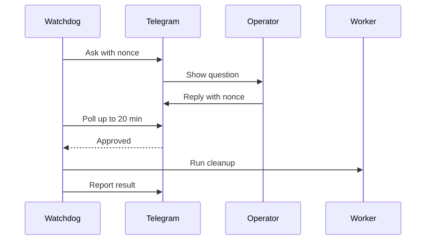

# 13 — Ingestion Operations

[Docs home](README.md) · Related: [12 — Airflow and the Python migration](12-airflow-and-python-migration.md) · [14 — Article metadata and deduplication](14-article-metadata-and-deduplication.md)

---

> **Code baseline.** This document reads `origin/master` at `d794b8c` and
> `origin/airflow_migration` at `2769828` (2026-11-01). Files that exist only on the
> branch are written as plain code text, not as links.

## 1. What changed

The team now ingests whole monthly manifests ([§2](#2-scale-of-real-runs)), so it added
recovery inside the pipeline and two background programs around it. The supervisor is
temporary: the migration plan replaces it with Airflow retries
([§8](#8-what-happens-at-cutover)).

| Part | Job | Where | Confidence |
|---|---|---|---|
| Failed-file recycling | Keeps a run alive through Common Crawl errors | [ingestion/pipeline.py](../ingestion/pipeline.py), `master` | Verified in code |
| Ingest supervisor | Relaunches ingestion when the driver stops | [scripts/supervise_ingest.py](../scripts/supervise_ingest.py), `master`; newer version on the branch | Verified in code |
| Telegram client | Sends alerts, reads messages, waits for approvals | [scripts/tg_alert.py](../scripts/tg_alert.py), `master` | Verified in code |
| Ops watchdog | Restarts the supervisor, alerts, answers Telegram | `scripts/ops_watchdog.py` (branch only) | Verified in code |
| Spark settings | Executor cores and YARN application master memory | [scripts/run_processing.sh](../scripts/run_processing.sh), `master` | Verified in code |

Whether the two background programs run today: [[FILL: are the supervisor and watchdog running on spark-master, and with which --interval]].

**Level 1: how the parts relate**



*Source: [diagrams/src/13-ops-layers.mmd](diagrams/src/13-ops-layers.mmd)*

The operator talks to the watchdog through Telegram, and the watchdog keeps the
supervisor alive. The supervisor relaunches the ingest driver, which remains the only
database writer. When the watchdog needs judgment, it can wake an OpenCode agent.

## 2. Scale of real runs

The prototype snapshot in [02 §6.1](02-hardware-and-infrastructure.md#61-prototype-snapshot-baseline-units)
holds 2,000 articles, but the code records much larger runs. *(Recorded: constants and
comments in `scripts/ops_watchdog.py`, branch only)*

| Manifest | Size | Articles |
|---|---|---|
| `2026/05` | 0.348 TiB | 2,380,649 committed |
| `2026/09` | 0.364 TiB | About 2.49 million expected, by size ratio (estimate, not a result) |

The supervisor launches ingestion with `SPARK_EXECUTOR_INSTANCES=5`,
`--max-files-per-round 5`, and `--num-files all`. *(Verified in code)*

## 3. Failed-file recycling in the ingestion driver

Before this change, one failed file ended the whole run. Now the driver tolerates
failures while it keeps making progress.

**Level 2: how the driver treats failures**



*Source: [diagrams/src/13-failed-file-flow.mmd](diagrams/src/13-failed-file-flow.mmd)*

A wave with failures no longer stops the run unless three waves in a row fail and commit
nothing. When no tasks remain, failed files return to `pending` if Common Crawl answers,
up to four times per invocation. Otherwise the run ends `failed` with exit 1.
*(Verified in code: `run_streaming_pipeline`)*

| Rule | Value |
|---|---|
| Consecutive blank failed waves before exit 1 | 3 |
| Recycles per invocation | 4 |
| Liveness probe | Range request for the first 4,096 bytes, 30-second timeout |
| Counts as alive | HTTP 200–399 and any 4xx. HTTP 5xx and network errors do not |

A wave that inserts articles resets the blank-wave counter. The recycle counter does not
reset within an invocation.

## 4. Ingest supervisor

### 4.1 Behavior

**Level 2: one supervisor loop**



*Source: [diagrams/src/13-supervisor-loop.mmd](diagrams/src/13-supervisor-loop.mmd)*

Every interval (120 seconds by default), the supervisor stops if all files are done.
Otherwise it relaunches ingestion when no driver is running and Common Crawl answers.
Before relaunching, it waits up to about two minutes for advisory locks to clear.
*(Verified in code)*

```bash
scripts/supervise_ingest.py start [--interval SECONDS]
scripts/supervise_ingest.py stop [--with-run]
scripts/supervise_ingest.py status
```

`stop` leaves a running ingestion alive and prints its process IDs; `--with-run` kills
it too. `status` shows the supervisor, the drivers, the YARN application, and progress.

### 4.2 Two versions

| | `master` | `airflow_migration` |
|---|---|---|
| Tracks | One fixed run ID (`bf82b942-…`) | One manifest (`2026/09`) |
| Relaunch | Resumes that run with `--resume-run-id` | Starts a **new** run each time |
| Launcher | Shell launcher | `.venv/bin/python -m jobs.launcher ingest` |

A new run loses no work: `create_run` copies progress from `ingest_files`. The side effect
on completion detection is in [§7](#7-known-issues).

## 5. Ops watchdog

The watchdog is a detached daemon that works independently of the supervisor.
Commands: `scripts/ops_watchdog.py start [--interval 600] | stop | status`.
*(Verified in code; every value in this section)*

### 5.1 Alerts

| Trigger | Threshold | Action |
|---|---|---|
| Supervisor down, files left | Pidfile dead | Restart it; alert at most hourly |
| Supervisor down, run complete | Pidfile dead and all files `eof` | Do not restart it; send a "run complete" message at most hourly, and end that check |
| No commit progress | 30 minutes with a driver running | Alert and wake the agent |
| Low disk, master | Under 1 GB on `/` or `/home` | Alert and wake the agent |
| Low disk, worker | Under 1 GB on `/home` | Ask for approval to clean up |
| Milestone | Every 100,000 articles | Telegram update |
| Periodic report | Every 4 hours | Status and estimated finish time |

Each alert type repeats at most once per hour.

The "run complete" rule uses the same count as the supervisor: rows across all runs of the
manifest. The completion issue in [§7.2](#72-supervisor-behavior) therefore applies to it
too: if rows from older runs never reach `eof`, this rule does not fire, and the watchdog
restarts a stopped supervisor as before.

### 5.2 Telegram commands

| Message starts with | Action |
|---|---|
| `status` | Reply with file and article counts, supervisor and driver state |
| `report` or `est` | Same, plus rate and estimated finish time |
| `stop` | Terminate the supervisor and the driver |
| `start` | Restart the supervisor |
| Anything else | Forward to the OpenCode agent and return its reply |

### 5.3 Approval for worker cleanup



*Source: [diagrams/src/13-approval-sequence.mmd](diagrams/src/13-approval-sequence.mmd)*

The watchdog sends a question with a random nonce and waits up to 20 minutes. Only a
reply containing that nonce approves the action; silence means no action, and the alert
returns on a later check.

### 5.4 Agent escalation

The watchdog wakes the agent with `opencode run --auto` in one fixed session, limited to
25 wake-ups per day. If it detects a plan limit, it stops using the agent for that day
and keeps monitoring and alerting by itself.

## 6. Files outside the repository

All of these live in the home directory of the `spark-master` user.

| File | Used by | Holds |
|---|---|---|
| `~/tg_bot_token` | Telegram client | Bot token (secret) |
| `~/tg_binding.json` | Telegram client | Allowed `chat_id` |
| `~/tg_updates.offset` | Telegram client | Last message read |
| `~/sudo_pw` | Watchdog | Sudo password in a plain file (secret) |
| `~/supervise_ingest.pid`, `.log` | Supervisor | Process ID and log |
| `~/ingest_wave.log` | Supervisor | Output of relaunched runs |
| `~/ops_watchdog.pid`, `.log`, `.state` | Watchdog | Process ID, log, and JSON state |

The Telegram client's docstring asks for these secrets to have `600` permissions. Nothing
in the code enforces it. *(Verified in code)*

New Spark settings are listed in [03 §3.3](03-cluster-design.md#33-spark-settings-applied-by-the-repository).

## 7. Known issues

These are recorded only, not fixed. Evidence is from reading the code; nothing here was
executed. They are also listed in [11](11-roadmap-and-open-questions.md).

### 7.1 Watchdog behavior

| Issue | Evidence | Effect | Confidence |
|---|---|---|---|
| Telegram commands are never read at the default interval | The loop runs a full check when 600 seconds have passed, otherwise it reads Telegram. The default `--interval` sleeps 600 seconds, so the full check always wins | With the default, `status`, `stop`, and `start` get no reply. A shorter `--interval` avoids this | Verified in code |
| The stall alert fires only if a check runs late | `state["ts"]` updates on every check, so the 30-minute test measures the time since the last check, not since the last commit | At a 10-minute interval, a hung run normally raises no alert | Verified in code |
| `stop` from Telegram does not last | `stop` terminates the supervisor, and no flag records the request. The next check finds it down and restarts it | Ingestion comes back after a manual stop | Verified in code |
| A failed database query skips the check | `manifest_counts` calls `row.replace(...)` on `None` when `db_query` fails | Disk and supervisor checks are skipped for that pass while the database is unreachable | Verified in code |
| The approval text differs from the command | The question mentions YARN logs and temp directories. The command runs `rm -rf /var/lib/hadoop-yarn/cache/* /tmp/spark*`. `action_snippet` is never used | The operator approves something different from what runs | Verified in code |
| Cleanup always reports success | `run_sudo` ignores the exit code of the remote command | `[ok]` can follow a failed cleanup | Verified in code |

### 7.2 Supervisor behavior

| Issue | Evidence | Effect | Confidence |
|---|---|---|---|
| Completion may never be detected on the branch | Each relaunch makes a new run, and `file_counts` counts rows across all runs of the manifest. Rows in older runs that stopped early never reach `eof` | The supervisor keeps relaunching after the month is finished, adding a new run each time | Verified in code |
| Any Spark job counts as an ingest driver | `DRIVER_PATTERNS` includes `org.apache.spark.deploy.SparkSubmit` | A running chunk, tag, or embed job blocks relaunch, and `stop --with-run` would kill it | Verified in code |
| Any advisory lock blocks relaunch | The check counts all advisory rows in `pg_locks`, not the ingestion lock | Other stages' locks delay relaunch | Verified in code |
| Database settings use different names | Both programs read `POSTGRES_*` from `.env`; the project and `.env.example` use `PG*`. Live state: [[FILL: does the live .env define POSTGRES_HOST, POSTGRES_USER, POSTGRES_DB, POSTGRES_PASSWORD]] | If those keys are absent, every query fails: relaunch never happens and the watchdog's checks abort | Verified in code; live `.env` unknown |

### 7.3 Recycling and security

| Issue | Evidence | Effect | Confidence |
|---|---|---|---|
| Recycling does not separate error types | All `failed` files return to `pending`, including a file whose ETag changed | Permanent errors are retried up to four times | Verified in code |
| Free-text Telegram goes to an agent running with `--auto` | `drain_inbox` passes unknown messages to `escalate` | Any message in the bound chat can start autonomous actions on the master | Verified in code |
| `wait-reply` does not check the chat | `cmd_wait_reply` matches the nonce without comparing `chat_id`, unlike `cmd_inbox` | A message with the nonce from another chat would approve. The nonce is sent only to the bound chat | Verified in code |
| Sudo password stored in a plain file | `run_sudo` reads `~/sudo_pw` | Anyone with access to that account can read it | Verified in code |
| Values fixed in code | Manifest ID (changed by hand each month), repository path, worker addresses, agent session ID | A monthly edit is needed; the scripts are tied to this cluster | Verified in code |
| Log files are tracked in git | `ingest_resume.log` and `ingest_watchdog.log` are committed; `.gitignore` has no matching rule | Repository noise | Verified in code |

## 8. What happens at cutover

The migration plan retires `scripts/supervise_ingest.py` in its Phase 6, after
`news_pipeline` has proved itself on real runs. It does not mention the watchdog.
*(Verified: no mention of "watchdog" in `docs/airflow-migration.md` at `2769828`.)*

This matters because the watchdog restarts the supervisor whenever it finds it down.
Until someone updates it, deleting the supervisor would leave the watchdog trying to
restart a missing file. Decision needed: [[FILL: will ops_watchdog be retired or rewritten when the supervisor is removed]].

The stage cutover has already touched this area: on the branch, the supervisor's launch
command uses `jobs.launcher` *(Verified in code)*. The watchdog's alerting would still be
useful under Airflow only if its checks are rewritten around DAG runs *(Inferred)*.
