# 14 — Article Metadata and Deduplication

[Docs home](README.md) · Related: [12 — Airflow and the Python migration](12-airflow-and-python-migration.md) · [13 — Ingestion operations](13-ingestion-operations.md)

---

> **Code baseline.** This document reads `origin/master` at `d794b8c` (2026-10-26). The
> change came in commit `4359933`. Sources: [ingestion/extraction.py](../ingestion/extraction.py),
> [ingestion/pipeline.py](../ingestion/pipeline.py), [db/db_handler.py](../db/db_handler.py).

## 1. Summary

Ingestion now keeps much more information about each article: structured dates, the
publisher, the section, keywords, a canonical URL, and a bounded copy of the page's raw
metadata. It also stores the two values that a future deduplication step needs.

**Deduplication itself does not exist yet.** The columns are there, but nothing detects
a duplicate or sets `duplicate_of`, and no stage skips duplicates
([§6](#6-deduplication-status)). *(Verified in code)*

## 2. Extraction flow

**Level 1: where the new fields come from**



*Source: [diagrams/src/14-metadata-extraction.mmd](diagrams/src/14-metadata-extraction.mmd)*

The executor reads meta tags, JSON-LD blocks, and the canonical link from the raw HTML,
before it removes page elements such as `script` and `header`. It then normalizes the
values into one candidate article, which the driver commits to `pages` and `metadata`.
*(Verified in code: `extract_html_fields`)*

When a page has several JSON-LD objects, article-shaped ones come first, in this order:
`NewsArticle`, `ReportageNewsArticle`, `Article`, `BlogPosting`, `WebPage`.

## 3. New database columns

*All rows are Verified in code: `init_db` in [db/db_handler.py](../db/db_handler.py).*

### 3.1 `pages`

| Column | Type | Meaning |
|---|---|---|
| `canonical_url` | `TEXT` | Canonical link as declared by the page, resolved to an absolute URL |
| `canonical_key` | `TEXT` | Normalized comparison key ([§5](#5-canonical-url-rules)) |
| `text_hash` | `TEXT` | SHA-256 of the article's cleaned text |
| `duplicate_of` | `INT`, references `pages(id)` | Original page. Reserved: nothing writes it |
| `duplicate_reason` | `TEXT` | Why it is a duplicate. Reserved: nothing writes it |

`pages.text_hash` covers a whole article. It is a different value from
`article_chunks.text_hash`, which covers one text chunk.

New indexes: `idx_pages_canonical_key`, `idx_pages_text_hash`, and the partial index
`idx_pages_live` (`WHERE duplicate_of IS NULL`).

### 3.2 `metadata`

| Column | Type | Source, in priority order | Limit |
|---|---|---|---|
| `published_at` | `TIMESTAMPTZ` | Parsed from `published_date` | None |
| `modified_at` | `TIMESTAMPTZ` | Meta `article:modified_time`, `og:updated_time`, `last-modified`; JSON-LD `dateModified` | None |
| `description` | `TEXT` | Meta `description`, `og:description`, `twitter:description`; JSON-LD `description` | 2,000 characters |
| `publisher` | `TEXT` | JSON-LD `publisher` | 300 characters |
| `in_language` | `TEXT` | JSON-LD `inLanguage`; `<html lang>` | Normalized code |
| `section` | `TEXT` | Meta `article:section`; JSON-LD `articleSection` | 200 characters |
| `keywords` | `TEXT[]` | Meta `keywords`, then JSON-LD `keywords` | 20 terms |
| `tags` | `TEXT[]` | Meta `article:tag`, then JSON-LD `about` or `mentions` | 20 terms |
| `author_names` | `TEXT[]` | Extracted author, then JSON-LD `author` | 10 names |
| `html_meta` | `JSONB` | Raw meta tags, links, and JSON-LD | 32 KiB ([§4](#4-bounds-on-html_meta)) |
| `html_size_bytes` | `INT` | Size of the raw HTML record | None |

**Other behavior changes:**

- `title` falls back to the JSON-LD `headline` when a page has no `<title>`.
- `in_language` is what the page declares. `language` is still the language the system detects, and it decides whether an article is kept.
- A date with no time zone is treated as UTC. A date that cannot be parsed becomes `NULL`, while `published_date` keeps the original text.

## 4. Bounds on `html_meta`

The limits stop one unusual page from bloating a row. *(Verified in code:
`_html_meta_payload`)*

| Limit | Value |
|---|---|
| One meta value | 2,000 characters |
| One JSON-LD block | 8 KiB (larger blocks are dropped) |
| JSON-LD blocks kept | 8 |
| Whole payload | 32 KiB |

If the payload is too large, the code first drops all JSON-LD. Next it keeps a compact
form (40 keys, 3 values each, 256 characters per value) with `"truncated": true`.
Finally it keeps only the key names.

**Storage impact.** At 32 KiB per article, the 2,380,649 articles of `2026/05`
([13 §2](13-ingestion-operations.md#2-scale-of-real-runs)) give an upper bound of about
73 GiB for `html_meta` before PostgreSQL compression. This is a worst-case limit, not a
measurement. *(Recommended, not measured)*

## 5. Canonical URL rules

`canonical_url` keeps the page's declared link. `canonical_key` is the normalized form
used for comparison. If a page declares no valid canonical link, the key comes from the
page's own URL. *(Verified in code: `normalize_url`, `_canonical_pair`)*

| Rule | Effect |
|---|---|
| Scheme | HTTP and HTTPS only; anything else gives no key |
| Host | Lowercase, without a leading `www.` or trailing dot |
| Port | Removed when it is the default for the scheme |
| Path | URL-decoded, trailing slash removed |
| Query | Sorted; `utm_*` and known tracking keys (such as `fbclid`, `gclid`, `msclkid`) removed |
| Fragment | Removed |

Example, produced by running `normalize_url`:

```text
Input:  https://www.Example.com:443/news/story/?utm_source=x&b=2&a=1&fbclid=z#top
Output: https://example.com/news/story?a=1&b=2
```

## 6. Deduplication status

**Level 2: what exists and what is missing**


*Source: [diagrams/src/14-dedup-status.mmd](diagrams/src/14-dedup-status.mmd)*

Ingestion already stores the canonical key and the text hash. The grey steps do not
exist: no code compares those values, writes `duplicate_of`, or filters on it.
Chunking, tagging, and embedding therefore still process every page, duplicates
included. *(Verified in code: `duplicate_of` appears only in the table definition and
`idx_pages_live`)*

Open decision: [[FILL: which job will set duplicate_of, and must stages skip duplicates]].

## 7. Known issues

These are recorded only, not fixed. Evidence is from reading the code; nothing here was
executed. They are also listed in [11](11-roadmap-and-open-questions.md).

| Issue | Evidence | Effect | Confidence |
|---|---|---|---|
| A database created before this change does not get the new columns | `init_db` runs its main DDL only when `ingest_schema_versions` has no version 2 row. The new columns are only in `CREATE TABLE IF NOT EXISTS`, with no `ALTER TABLE … ADD COLUMN`, and the new indexes are in the same DDL | On a database with version 2 recorded, `init_db` skips the DDL with no error, so the new columns and indexes are not added. The failure appears later, at the `INSERT` into `pages`, which names columns that do not exist. This is not a rejected row, so nothing goes to `dead_letter/`: the driver retries the commit up to `MAX_RETRIES` attempts, then the run stops with an error. If an older database has no version 2 row, the DDL runs and `init_db` fails at the new indexes | Verified in code |
| Rows from before the change have empty values | The change adds no backfill | Older articles have `NULL` in the new columns, so future deduplication cannot see them | Verified in code |
| The `init_db` docstring is no longer one | A `raise` was added before the text in `init_db` | Tools no longer see the docstring. Runtime behavior is not affected | Verified in code |

**Check the live database.** State: [[FILL: does the live warcdb have the new pages and metadata columns, and how were they added]].

```bash
psql -d warcdb -c "\d pages"
psql -d warcdb -c "\d metadata"
```

The expected result is that `canonical_key`, `text_hash`, and `html_meta` are listed.

## 8. Tests

`tests/test_ingestion.py` gained these cases *(Verified in code)*:

| Test | Covers |
|---|---|
| `test_canonical_jsonld_and_meta_enrichment` | Extraction of the new fields |
| `test_canonical_relative_and_invalid_fallback` | Relative and invalid canonical links |
| `test_html_meta_payload_is_bounded` | The 32 KiB limit |
| `test_candidate_carries_enrichment_and_text_hash` | Fields reaching the candidate |
| `test_enrichment_columns_round_trip` | Writing and reading the new columns |
