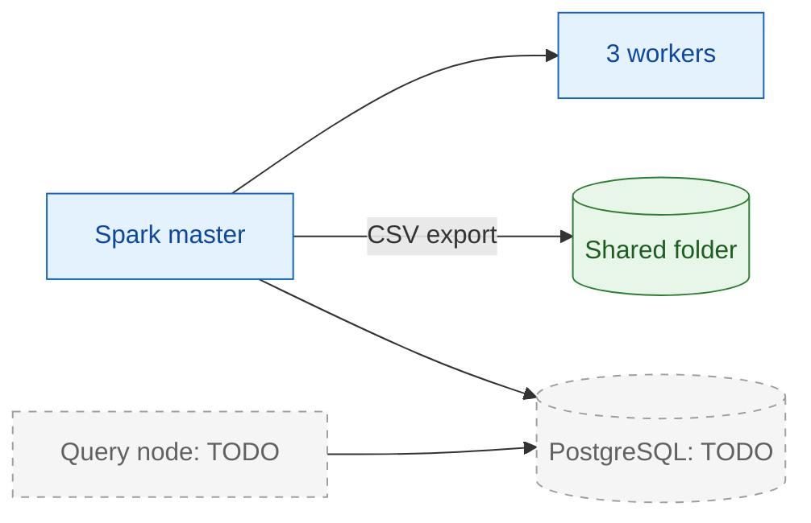

# 02 — Hardware and Infrastructure

[Docs home](README.md) · Previous: [01 — System overview](01-system-overview.md) · Next: [03 — Cluster design](03-cluster-design.md)

---

> **Read this first.** The repository contains no infrastructure-as-code: no Dockerfile,
> Compose, Kubernetes, Hadoop or YARN configuration, VM definitions, or PostgreSQL
> provisioning. This page lists what the repository does reveal, derives
> **recommended minimums** from code settings, and marks every other value
> **TODO(team)**. Use [Commands to collect real specs](#7-commands-to-collect-real-specs)
> to fill in the gaps.

## 1. Evidence found in the repository

| Fact | Where it comes from | Confidence |
|---|---|---|
| A Debian host runs VMware VMs; helper scripts `cluster_up.sh` and `cluster_down.sh` start and stop the VMs and Hadoop services "on the Debian host, not inside a VM" | [README.md](../README.md) (Setup section) | Recorded in docs. The scripts are **referenced but not present** in the repository. |
| One Spark/YARN master reachable as `spark-master:8032` | [archive/validation.md](archive/validation.md) ("YARN cluster validation, `spark-master:8032`, 3 workers RUNNING") | Recorded |
| Three workers: `worker1`, `worker2`, `worker3` | [archive/validation.md](archive/validation.md) | Recorded |
| Worker VMs have 2 GiB RAM | Comment `# 1.5 GiB YARN container for 2 GiB worker VMs` in [.env.example](../.env.example); [archive/processing.md](archive/processing.md) | Verified in config (comment) |
| HDFS and YARN are present on the cluster | `hdfs dfs` calls and `--master yarn` in [scripts/run_processing.sh](../scripts/run_processing.sh) | Verified in code |
| Spark jobs run in YARN **client** mode, so the driver runs on the machine that launches the script | `--master yarn --deploy-mode client` in [scripts/run_processing.sh](../scripts/run_processing.sh) | Verified in code |
| Launchers are expected to run on the Spark master | [README.md](../README.md): "Run ingestion on the Spark master with HDFS and YARN available" | Recorded in docs |
| PostgreSQL must be reachable from the master; executors never connect to it | [README.md](../README.md); stage pipelines pass only plain dicts to executors | Verified in code |
| PostgreSQL defaults to `localhost:5432` | `_db_config()` in [db/db_handler.py](../db/db_handler.py#L16-L27) | Verified in code |
| PostgreSQL needs the `vector` extension | `CREATE EXTENSION IF NOT EXISTS vector` in [db/vector_schema.py](../db/vector_schema.py#L4) | Verified in code |
| A VMware shared folder (HGFS) is mounted at `/mnt/hgfs/copy_path/` | Default destination in [scripts/export_csv.sh](../scripts/export_csv.sh#L11) | Verified in code (mount itself: Inferred) |
| No GPU is used anywhere | Both ONNX sessions use `CPUExecutionProvider` only ([embeddings/embeddings.py](../embeddings/embeddings.py), [retrieval/reranker.py](../retrieval/reranker.py)) | Verified in code |
| Spark 4.2.0 and PostgreSQL 18 were used in past validation | [archive/validation.md](archive/validation.md) | Recorded |

## 2. Node roles





Solid nodes are confirmed by the repository: one Spark/YARN master, three 2 GiB worker
VMs, and the VMware shared folder that receives CSV exports. Grey dashed nodes are
required by the code, but their host is TODO(team), as is the HDFS NameNode's. The
`localhost` database default suggests PostgreSQL ran on the master during development
*(Inferred)*.

| Role | Responsibilities | Required software | Confidence |
|---|---|---|---|
| **Debian host** | Runs the VMs; runs `cluster_up.sh` / `cluster_down.sh` (not in repo) | VMware TODO(team) | Recorded |
| **Spark/YARN master** | YARN ResourceManager; Spark driver for all four stages; launcher packaging; DB connections of every stage | Java, Spark, Hadoop client (`hdfs`), Python 3 + `.venv`, `zip`, `tar`, `sha256sum`, `curl`, `psql` | Verified in code (software); versions TODO(team) |
| **Worker** (x3) | YARN NodeManager; runs one Spark executor container per core assigned | Java, Hadoop/YARN; the **same Python version and interpreter path** as the packed venv ([README.md](../README.md)) | Recorded / Inferred |
| **PostgreSQL** | System of record for all data, checkpoints, and vectors | PostgreSQL with the pgvector extension | Verified in code; version TODO(team) |
| **Query node** | Runs `scripts/ask.py` with both ONNX models in memory | Python 3 + `.venv-rag`, `.models/` | Verified in code; host TODO(team) |

## 3. Sizing table

### 3.1 Known and unknown specifications

The Source column says where each value comes from.

| Node role | Count | vCPU | RAM | Disk | Source |
|---|---|---|---|---|---|
| Debian host | 1 | TODO(team) | TODO(team) | TODO(team) | Count: code/config ([README.md](../README.md)). Specs: TODO(team) |
| Spark/YARN master | 1 | TODO(team) | TODO(team) | TODO(team) | Count: code/config ([archive/validation.md](archive/validation.md)). Specs: TODO(team) |
| Worker | 3 | TODO(team) | 2 GiB | TODO(team) | Count and RAM: code/config ([archive/validation.md](archive/validation.md), [.env.example](../.env.example)). vCPU, disk: TODO(team) |
| PostgreSQL | TODO(team) | TODO(team) | TODO(team) | TODO(team) | TODO(team) |
| Query node | TODO(team) | TODO(team) | TODO(team) | TODO(team) | TODO(team) |

### 3.2 Recommended minimums — *Recommended, not measured*

These values come from the memory, thread, and model settings in code. No benchmark
supports them. Replace them with measured values once the team has data.

| Node role | Count | vCPU | RAM | Disk | Derivation |
|---|---|---|---|---|---|
| Spark/YARN master | 1 | 2 | 4 GiB | 40 GB | Spark driver heap `512m` plus a Python driver process; ResourceManager (and possibly NameNode) JVMs. Launcher archives in `.build-tmp/` are never cleaned up automatically: one packed venv per environment fingerprint, one `spark-libs-*.zip` per Spark jar set, one `embedding_model-*.tar.gz` (larger than 500 MB) per model fingerprint. |
| Worker | 3 | 2 | 2 GiB (today) to 4 GiB | 20 GB | One executor core each (`spark.executor.cores=1`). Container size is 1 GiB for ingest, chunk, and tag (`512m` heap + `512m` overhead) and 1.5 GiB for embed (`512m` + `1g`). The extra vCPU and RAM are for NodeManager and OS daemons. Disk holds YARN-localized venv, Spark-libs, and model archives plus logs. |
| PostgreSQL | 1 | 2 | 4 GiB | 20 GB SSD (prototype) | The prototype snapshot is well under 1 GB (see §6). Exact cosine search scans every vector of the selected version, so RAM large enough to cache `chunk_embeddings` keeps queries fast *(Inferred)*. |
| Query node | 1 | 2 | 4 GiB | 5 GB | Holds the BGE-M3 INT8 graph (the setup script rejects files under 500,000,000 bytes) and the reranker INT8 graph ("570 MB-class", per [README.md](../README.md)) plus tokenizers and Python. Up to 3 concurrent database searches (`RAG_DB_CONCURRENCY`). |

**Measured executor footprint** *(Recorded, ingestion only, 2026-09-30)*: Python RSS
about 195–221 MiB, JVM RSS about 223–233 MiB, and JVM heap about 50–64 MiB per
executor; the driver JVM RSS was about 400 MiB ([archive/validation.md](archive/validation.md)).
There is no recorded measurement for the embedding, tagging, or chunking stages.

### 3.3 GPU

Not required. All inference runs on CPU through ONNX Runtime with one intra-op thread
by default. The tagging backend contract allows a future GPU-backed adapter, but no GPU
scheduling or configuration exists in the repository.
*(Verified in code; GPU adapter: Proposed (not implemented))*

## 4. YARN container budget per stage

Each Spark job requests a fixed number of executors with one core each. Dynamic
allocation is disabled. *(Verified in code: [scripts/run_processing.sh](../scripts/run_processing.sh), [jobs/launch_config.py](../jobs/launch_config.py), [jobs/runtime.py](../jobs/runtime.py))*

| Stage | Default executors | Executor heap | Overhead | Container size | Total executor memory | Override variables |
|---|---:|---:|---:|---:|---:|---|
| ingest | 3 | 512m | 512m | 1 GiB | 3 GiB | `SPARK_EXECUTOR_MEMORY`, `SPARK_EXECUTOR_MEMORY_OVERHEAD` |
| chunk | 3 | 512m | 512m | 1 GiB | 3 GiB | same |
| tag | 3 | 512m | 512m | 1 GiB | 3 GiB | same |
| embed | 2 | 512m | 1g | 1.5 GiB | 3 GiB | `EMBEDDING_EXECUTOR_MEMORY`, `EMBEDDING_EXECUTOR_MEMORY_OVERHEAD`, which fall back to the generic variables |
| driver (all) | — | 512m | — | runs on the launcher host | — | `SPARK_DRIVER_MEMORY` |

Each job also starts a YARN ApplicationMaster container, sized by Spark defaults that
the repository does not configure *(Inferred)*. With three 2 GiB workers, that
ApplicationMaster occupies capacity on one worker. That is why embedding defaults to two
executors ([archive/processing.md](archive/processing.md); the default of 2 is
*Verified in code*). Running two stages at the same time needs roughly twice these
container totals. The current three-worker cluster cannot satisfy that at the defaults
*(Inferred)*.

## 5. Network and storage requirements

### 5.1 Network flows

| From | To | Port / protocol | Purpose | Confidence |
|---|---|---|---|---|
| Spark master (driver) | `data.commoncrawl.org` | 443 / HTTPS | Download the monthly `warc.paths.gz` manifest | Verified in code |
| Workers (ingestion executors) | `data.commoncrawl.org` | 443 / HTTPS with Range requests | Stream WARC files | Verified in code |
| Workers (tagging executors) | Groq API | 443 / HTTPS | Chunk analysis | Verified in code (endpoint host is the `langchain-groq` default: Inferred) |
| Spark master (driver) | PostgreSQL | 5432 / TCP | All stage reads and writes | Verified in code (port default) |
| Query node | PostgreSQL | 5432 / TCP | Vector search | Verified in code |
| Query node | Groq or Google Gemini APIs | 443 / HTTPS | Planning and answering | Verified in code |
| Setup host | `huggingface.co`, `pypi.org` | 443 / HTTPS | One-time model and package downloads | Verified in code |
| Spark master | YARN ResourceManager | 8032 / TCP | Job submission | Recorded |
| Spark master | HDFS NameNode | TODO(team) | Archive cache under `HDFS_APPS_DIR` | Verified in code (port: TODO(team)) |
| Spark driver | Executors | Spark driver and block-manager ports | Task dispatch and result collection | Inferred (Spark defaults; repo sets none) |

Workers need outbound internet access for ingestion and tagging but **do not** need
PostgreSQL access. *(Verified in code)*

### 5.2 Storage locations

| Location | Host | Contents | Growth | Confidence |
|---|---|---|---|---|
| `.build-tmp/` | Launcher host | Packed venv archives, Spark-libs zips, embedding model archives, per-run temporary dirs | One archive per fingerprint; no cleanup | Verified in code |
| `.models/bge-m3/` | Setup host | Base BGE-M3 tokenizer and config files (source for the INT8 package) | Fixed | Verified in code |
| `.models/bge-m3-int8/` | Launcher host and query node | Embedding ONNX graph (larger than 500 MB) and tokenizer | Fixed per revision | Verified in code |
| `.models/bge-reranker-v2-m3-int8/` | Query node | Reranker ONNX graph and tokenizer | Fixed per revision | Verified in code |
| `dead_letter/` (or `DEAD_LETTER_DIR`) | Launcher host | JSONL rows rejected by PostgreSQL | Per rejected batch | Verified in code |
| `exports/` | Launcher host | CSV exports of 9 tables | Overwritten per export | Verified in code |
| `/mnt/hgfs/copy_path/warcdb_csv/` | Launcher host (VMware share) | Copy of the CSV export | Overwritten per export | Verified in code (path) |
| HDFS `HDFS_APPS_DIR` (default `/user/$USER/apps/spark`) | HDFS | Shared venv, Spark-libs, and model archives | One per fingerprint; no cleanup | Verified in code |
| HDFS `/spark-logs/` | HDFS | Spark event logs | Per application | Recorded (configured outside repo) |
| PostgreSQL data directory | DB host | All tables and indexes | See §6 | Verified in code |

## 6. Estimation method

There are no production targets yet. Production sizing is **TODO(team)**. This section
explains how to extrapolate from the prototype snapshot once targets exist.

### 6.1 Prototype snapshot (baseline units)

Measured from the CSV files in [exports/](../exports/) with a CSV parser (multi-line
text fields are counted correctly).

| Quantity | Value | Derived unit |
|---|---:|---|
| Articles (`pages`, `metadata`, `content`) | 2,000 | — |
| Language mix | en 1,627, fr 221, ar 152 | 81% / 11% / 8% |
| Average article length | 3,757 characters; 551 words | — |
| Chunk materializations | 2,000 | 1 per article |
| Text chunks (`article_chunks`) | 11,953 | 5.98 per article |
| Eligible text chunks | 10,145 | 5.07 per article (84.9%) |
| Average chunk length | 647 characters | — |
| Embeddings (`chunk_embeddings`) | 911 | 9% of eligible chunks embedded |
| Analyses (`chunk_analyses`) | 60: 49 `SUCCESS`, 6 `NOISE`, 5 `ERROR` (all five are Groq 429) | 0.6% of eligible chunks analysed |
| Websites / authors | 729 / 1,053 | — |

The filtered (ineligible) chunks break down as: `short` 800, `headlines` 789, `blocked` 121,
`aggregator` 39, `bio` 30, `garbled` 21, `non_article_url` 8.

### 6.2 Storage

Let *A* be the target number of articles.

| Item | Formula | Basis | Confidence |
|---|---|---|---|
| Article text | *A* × about 4 KB | 3,757 characters average; Arabic and accented characters take 2 bytes in UTF-8 | Inferred |
| Text chunks | *A* × 5.98 × about 0.7 KB | 647 characters average plus hash and keys | Inferred |
| Vectors | *A* × 5.07 × 4,104 bytes | pgvector stores `4 × dim + 8` bytes; dim = 1024 | Inferred (pgvector format) |
| HNSW index (`idx_chunk_embeddings_hnsw`) | Assume 1–2× vector data until measured | Depends on pgvector HNSW parameters (repo uses defaults) | Recommended, not measured |
| Each extra `embedding_version` or `chunking_version` | Repeats the vector or chunk cost | Versions are stored side by side, never replaced | Verified in code |

Example: 100,000 articles produce about 507,000 eligible chunks, which is about
2.1 GB of raw vector data, plus the index and row overhead *(Inferred)*.

To measure the real per-row cost on the live database (standard PostgreSQL functions):

```sql
SELECT relname, pg_size_pretty(pg_total_relation_size(oid)) AS total
FROM pg_class
WHERE relname IN ('content','article_chunks','chunk_embeddings','idx_chunk_embeddings_hnsw','chunk_analyses')
ORDER BY pg_total_relation_size(oid) DESC;
```

Divide each total by the row count from `./scripts/inspect_db.sh` or `SELECT count(*)`.

### 6.3 Embedding time

The repository records **no** embedding throughput measurement. *(TODO(team))*

Method:

1. Record a baseline: `./scripts/watch_embeddings.sh --once` (prints `eligible`, `embedded`).
2. Run a bounded job and note the start and end times: `./scripts/run_embeddings.sh --embedding-limit 500`.
3. Compute *t* = seconds ÷ 500 chunks for the cluster size used (default 2 executors, batch size 1, `max_length` 256, 1 ONNX thread).
4. Estimate the full run as *A* × 5.07 × *t*. Throughput scales roughly with the number of executors until the driver or database becomes the bottleneck *(Inferred)*.

### 6.4 LLM tagging cost and duration

Facts from code ([tagging/backends/groq.py](../tagging/backends/groq.py), [tagging/backends/groq_rules.py](../tagging/backends/groq_rules.py)):

- One request per eligible chunk; up to 5 attempts per chunk.
- Output is capped at `max_tokens=600`.
- The input is the prompt template plus the chunk text, title, and language name.
- Each worker paces requests by the largest of three intervals:
  - `TAG_REQUEST_INTERVAL_SECONDS` (default 1.5)
  - `60 × parallelism ÷ TAG_REQUESTS_PER_MINUTE`
  - `60 × parallelism × estimated_tokens ÷ TAG_TOKENS_PER_MINUTE`

The token estimate is the UTF-8 byte length of the prompt plus 600.

| Quantity | Formula |
|---|---|
| Requests | *A* × 5.07 × (1 + retry rate) |
| Input tokens (upper bound) | requests × (template bytes + about 650-character chunk bytes) |
| Output tokens (upper bound) | requests × 600 |
| Cost | tokens × provider price — **TODO(team)**: model, tier, and price |
| Minimum duration at default pacing | *A* × 5.07 × 1.5 s ÷ parallel tasks (default 3) |

Example: 2,000 articles is about 10,145 requests, or about 85 minutes at the default
pacing with 3 tasks, before retries *(Inferred)*. The 429 errors in the snapshot show
that the account's per-minute token limit is reached sooner than the default pacing
assumes (see Known Issues).

### 6.5 Prototype vs production sizing

| Node role | Prototype (known or recommended) | Production |
|---|---|---|
| Spark/YARN master | 1 node; specs TODO(team); recommended 2 vCPU / 4 GiB / 40 GB | TODO(team) |
| Workers | 3 × 2 GiB RAM; vCPU and disk TODO(team) | TODO(team) |
| PostgreSQL | Host TODO(team); recommended 2 vCPU / 4 GiB / 20 GB SSD | TODO(team): size from §6.2 once article targets exist |
| Query node | Host TODO(team); recommended 2 vCPU / 4 GiB / 5 GB | TODO(team): depends on query rate (none defined) |
| Proposed production components (scheduler, FastAPI service, monitoring, backups) | Not present | TODO(team) |

## 7. Commands to collect real specs

Run these on each VM (and on the host where applicable), then fill in the TODO(team)
cells above. They are standard tools and are not part of the repository.

```bash
# Operating system and hardware (every node)
lsb_release -a
nproc
free -h
df -h

# Hadoop / YARN / Spark (master)
hdfs version
yarn node -list -all
spark-submit --version
java -version

# Python (master and every worker: versions and interpreter paths must match)
python3 --version
which python3

# PostgreSQL and pgvector (database host)
psql --version
psql -d warcdb -c "SELECT version();"
psql -d warcdb -c "SELECT extversion FROM pg_extension WHERE extname = 'vector';"
```

**Expected output:** one line or a small table per command. Record the results in this
document's sizing table and in [11-roadmap-and-open-questions.md](11-roadmap-and-open-questions.md).

**Troubleshooting**

- `yarn: command not found` or `hdfs: command not found`: the Hadoop client binaries are not on `PATH`. Locate the Hadoop installation and add its `bin/` directory to `PATH`.
- If the pgvector query returns no rows, the extension is not installed in that database yet. `init_db()` creates it on the first run if the role has permission.
